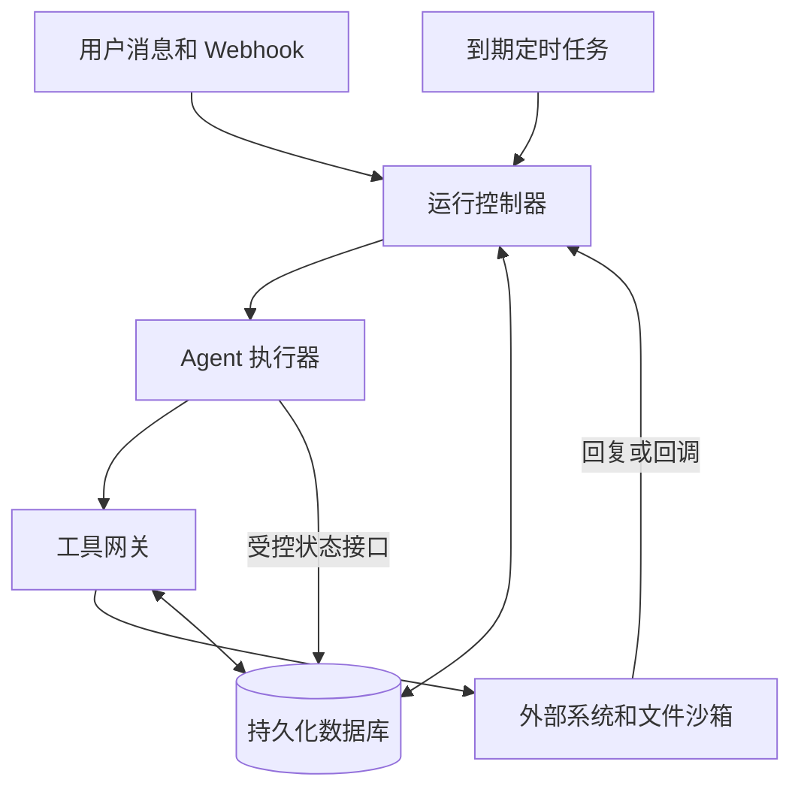

# Always On Agent 系统设计文档

本方案面向个人或小团队自托管的 always on agent 系统，覆盖信息跟踪、研究、代码工作和第三方工具操作。核心目标是在保持可靠执行的前提下，减少模块数量，使模型升级主要影响执行器、提示词和评测配置。

推荐采用三个逻辑模块、一个数据库和一个主 Agent 循环。长期维护任务状态、执行可靠性、权限与评测；规划、检索和任务分解尽量交给模型。第一版暂不考虑大规模多租户。

默认部署为单机单进程、SQLite WAL 和可直接编辑的 Markdown 工作区。模型使用少量通用工具，通过 CLI 和按需读取的 Skills 扩展能力。外部副作用统一经过授权与动作记录，避免将工具数量的精简变成执行边界的缺失。

**1 设计依据与核心原则**

原文提出 inbox、timers、memory、permissions、outbox 五个原语，覆盖唤醒、跨会话连续性、授权和结果交付。这些是职责，不必拆成五个服务。[Building always-on agents](https://claude.com/resources/articles/building-always-on-agents)

本设计吸收四项实践：从简单可组合的 Agent 模式开始；区分会话检查点与长期存储；长任务留下可验证的交接记录；可重试操作明确处理幂等性。对应参考：[Anthropic Agent 构建实践](https://www.anthropic.com/research/building-effective-agents)、[LangGraph 持久化设计](https://docs.langchain.com/oss/python/langgraph/persistence)、[长任务 harness 实践](https://www.anthropic.com/research/effective-harnesses-for-long-running-agents)和 [Temporal Activity 文档](https://docs.temporal.io/activity-definition)。以下架构是基于这些实践提出的方案。

判断一个能力是否进入核心的标准是：如果下一代模型的规划、记忆和工具使用能力强十倍，它是否仍然需要存在？

| 长期保留的系统职责 | 保持轻量并允许替换的能力 |
| --- | --- |
| 事件持久化、定时唤醒 | 理解事件、判断价值 |
| 并发控制、故障恢复 | 任务拆解、步骤规划 |
| 授权、凭证隔离、预算 | 工具选择、策略调整 |
| 操作记录、去重与结果核对 | 总结、检索、上下文组织 |
| 任务、成果存储和升级评测 | 模型专用提示词、自我反思、多 Agent 协作 |

核心程序固化执行契约，模型决定契约范围内的工作方法。例如，可操作的仓库和预算上限是契约；先搜索还是先读代码是工作方法。

**2 整体架构**



三个模块属于代码边界，初期无需部署为三个微服务。一个 agentd 宿主进程承载 HTTP 接入、调度、执行器和工具网关，一个本机 SQLite 数据库保存系统事实；代码执行使用独立隔离环境，不能与持有凭证和数据库写权限的宿主进程共享权限。模型 API 和第三方系统属于外部依赖。

第一版不额外引入 Redis、专用消息队列、向量数据库或工作流平台。只有出现跨主机运行或持续写入争用时，才考虑迁移 PostgreSQL。SQLite WAL 使用本机文件系统，不放在多机共享网络盘上；写事务保持短小，不在事务内等待模型或网络请求。[SQLite WAL](https://www.sqlite.org/wal.html)

进程由服务管理器自动重启。数据库采用一致性备份，工作区保留版本；在线备份使用 SQLite Backup API 等受支持方式，不直接复制正在运行的数据库主文件。[SQLite 备份](https://www.sqlite.org/backup.html)

| 数据或动作 | 唯一写入负责人 |
| --- | --- |
| 事件、任务生命周期、Run、timer、工作空间租约 | 运行控制器 |
| 授权判定、审批消费、外部动作与回执 | 工具网关 |
| 模型消息和工具调用历史 | 执行器通过宿主持久化接口追加 |
| 笔记、候选技能和草稿文件 | 用户与 Agent，写入时做版本冲突检查 |
| 生效身份指令与技能 | 用户批准后由宿主安装；Agent 默认只读 |

模块之间使用进程内接口。共享数据库不意味着执行器或沙箱可以任意修改系统事实；跨模块状态提交由宿主事务协调，不新增通用服务框架。

**3 运行控制器的职责与边界**

控制器用确定性代码确保工作不会丢失，并在正确时间和状态下执行。包含事件接入、定时唤醒、生命周期管理和通知投递。

| 子职责 | 必须负责 | 边界 |
| --- | --- | --- |
| 事件接入 | 验签、持久化、来源去重、关联任务 | HTTP 请求不等待模型完成 |
| 调度 | 领取事件、到期唤醒、有限重试 | 不用模型轮询时间 |
| 并发控制 | 避免竞争修改共享状态 | 第一版不实现复杂并行任务图 |
| 生命周期 | 暂停、取消、等待、恢复、预算终止 | 不理解业务执行步骤 |
| 状态提交 | 保存运行结果、进度和后续事件 | 不以自然语言作为唯一状态 |
| 通知投递 | 重试、去重、静默时间、发送记录 | 不重新判断业务结论 |

第一版每个工作空间仅允许一个活跃 Run。等待用户或外部结果时结束当前 Run，释放执行槽位。后台事件默认进入下一轮；人工消息采用以下抢占规则。取消和全局急停走不依赖模型的控制路径。已发往外部系统的动作不保证可撤销。

接入先持久化事件再 ACK。普通消息按明确的会话或任务关联键合批，默认在最后一条消息后等待 1 秒，但从第一条起最多等待 3 秒，防止持续事件流造成饥饿；参数可配置。保存每条原始事件及顺序，仅合并本轮输入。审批回复和取消事件不走防抖。没有明确关联键的事件不靠语义猜测合批。

| 概念 | 定义 |
| --- | --- |
| Task | 用户委托的目标，可持续数天 |
| Run | 一次有时间和预算边界的执行 |
| Session | 模型对话上下文，可压缩或重建 |

一个 Task 可以经历多个 Run 和多个 Session。业务任务不依赖供应商会话 ID 才能继续。

**无关联消息与任务创建**

会话关联仅决定消息来自哪里，不自动决定其属于哪个 Task。控制器先按可信 task_id、reply_to 或审批 ID 关联，校验该用户有权访问目标；无明确关联的消息以 task=null 启动同一个执行器，并加载本会话的有限任务索引。无需独立分派模型或分类服务。

模型可以直接回答闲聊，也可通过 manage_task 提议 create、update 或 bind。控制器负责实际写入：按用户、来源事件和请求键去重，验证任务版本、允许的字段与权限。目标及验收条件可由模型根据委托起草；预算使用用户策略默认值，模型不能自行提高上限。更新既有目标需引用对应用户指令，实质性歧义先澄清；权限不随目标文字变化自动扩大。

bind 只建立事件与任务的关联，不隐式合并两个任务、预算或授权。无法确定消息属于 A 还是 B 时询问用户。task=null 的 Run 受会话级和日预算限制，仍记录 Run、消息和通知；持续工作、外部业务写入及后续 timer 必须先关联 Task。回复主用户的消息可仅关联会话和 Run。

manage_task 的最小契约如下；调用身份、工作空间、run_id 和有效授权由宿主注入，不能信任模型自报：

```text
create(request_key, source_event_ids, goal, acceptance?)
  → task_id, version, effective_budget
update(request_key, task_id, expected_version, patch, source_event_ids?)
  → task_id, new_version
bind(request_key, event_ids, task_id, expected_version)
  → task_id, version, session_ref
```

request_key 关联已持久化的工具调用，恢复重试复用；相同键但不同参数返回冲突。update 可更新进度、阻塞和成果引用；目标及验收条件变化必须关联用户指令。任务终态由控制器依据取消请求或验收结果提交，不能通过任意 patch 写入授权、预算或完成状态。持续进度通过该接口或 Run 提交写回，再生成 progress/ 视图。

Run 始终关联一个逻辑 session_id，即使 task_id 为空。明确的新委托使用独立任务 Session，普通无关联消息使用当前会话的消息处理 Session。bind 选中已有 Task 时，控制器持久化交接与事件关联，在工具边界结束当前分派 Run，再唤醒目标 Session；不在同一模型循环中静默替换历史，也不重复完成输入事件。多个相关事件的迁移和继续事件写入使用一个事务。

**前台抢占与纠偏**

| 到达事件 | 调度规则 |
| --- | --- |
| 可信地关联当前 Task 的人工补充 | 在下一工具或模型调用边界将事件追加到 Session，再注入下一次模型输入；改变目标时走 manage_task 更新 |
| 后台 Run 期间收到其他人工消息 | 接入层先确认收到，设置 yield_requested；当前安全边界保存进度和继续事件后让出执行槽 |
| 前台 Run 期间收到其他人工消息 | 默认排队，明确取消或停止指令走控制路径 |
| 后台事件 | 持久化排队，不打断前台交互 |

边界包括模型调用结束和工具返回；到达抢占宽限期时取消可中止的调用。初始宽限期可设为 5 秒，它约束取消尝试时间，不承诺第三方响应时间。长计算使用受限本地作业句柄和完成事件，或拆为有限步骤，不能靠长时间阻塞 bash 占用 Run。作业不持有写凭证、只能写其专属临时目录，并在重启时标记中断；无需支持任意进程内存恢复。

让出后，后台 Task 回到 ready 且保留一个去重的继续事件；前台队列清空后恢复。长期后台任务设置等待告警，前台持续繁忙时不偷偷并行修改共享工作区。纠偏到达后不再启动旧计划的新动作，已经在途的动作先记录或核对，不能回溯取消。

Steer 事件追加记录按 event_id 去重，并保留尚未处理的标记；只有相应处理结果、等待状态或交接已持久化后才将输入事件置为 done。不能仅因送入模型上下文就标记完成，否则调用中断会丢掉用户纠偏。接入层的“已收到”是收件确认，不代表任务已完成或模型已处理。

**4 Agent 执行器的职责与边界**

执行器在目标、状态、可用工具和预算范围内推进任务。默认使用一个循环：装配上下文 → 调用模型 → 请求工具 → 读取工具结果 → 继续判断，直至完成、等待、让出执行权或失败。

它负责读取相关信息、规划步骤、请求工具、整理成果与进度、提议后续唤醒。它不能直接修改权限、绕过预算或取得宿主环境全部凭证。

```text
run(task_or_null, events, context_refs, tool_capabilities, budget, checkpoint?)
  → RunResult

RunResult:
  status: completed | waiting | yielded | failed | cancelled
  progress
  artifact_refs
  evidence_refs
  wait_condition?
  continuation?
```

RunResult 是宿主与执行器之间的内部返回值，不要求模型每轮输出这份 JSON。状态由工具结果、模型结束信号、取消和预算事件共同形成；没有明确完成证据时不自动将 Task 标为 completed。模型适配器保留原生工具调用格式，仅在接口边界转换。

task=null 时 completed 仅表示本次消息处理结束。create 成功后，若当前 Session 仅含本次新委托，可直接关联为任务 Session；否则在工具边界创建带交接的任务 Session。bind 已有任务按前述交接规则恢复其 Session。控制器返回的任务、会话关联落盘后才能执行后续业务工具。

工具调用及结果在执行过程中持久化，不能只在最终 RunResult 中保存。否则崩溃会丢失已经发生的动作。

每次模型调用前估算输入、工具定义及预留输出的总预算。接近窗口上限时，在工具结果已落盘的边界生成可追溯摘要，保留用户约束、未完成动作 ID 和成果引用；原始记录仍可按需读取。摘要不替代授权和动作事实。若剩余空间不足以安全压缩或压缩失败，保存交接并 yield，下一 Run 用精简上下文继续。仍无法容纳的单次输入分段读取，不无限重试相同超限请求。

第一版只实现一个模型供应商，核心保留供应商无关的任务、成果和动作记录。原始响应及供应商特有内容原样保存，扩展能力通过可选字段接入。更换模型时允许从任务状态和成果重建 Session，不要求无损迁移旧模型内部上下文。

**5 工具网关的职责与边界**

工具网关将模型提出的动作转换为经过授权、可追踪的实际操作。调用顺序为：参数校验 → 权限检查 → 预算与取消检查 → 创建或读取动作记录 → 调用外部系统 → 保存结果。

```text
tool:
  name
  input_schema
  effect: read | write
  scope
  timeout
  retry_policy
  idempotency_support
```

这些字段是宿主的执行元数据，不要求为每个业务编写专用 Tool，也不必全部注入提示词。通用 bash 的副作用不能仅用一个静态 read/write 标记判定，必须由隔离环境与实际出口请求共同约束。

默认向模型提供以下基础工具，数量由闭环需要决定，不设永久上限：

| 工具 | 用途与最小参数 | 执行边界 |
| --- | --- | --- |
| bash | command、cwd、timeout | 工作区计算、CLI 和脚本；不持有生产凭证 |
| read_file | path、读取范围 | 仅授权路径 |
| write_file | path、content、expected_version | 新建或受版本保护地覆盖工作区文件 |
| edit_file | path、修改内容、expected_version | 冲突时拒绝覆盖并重新读取 |
| set_timer | create/cancel/list、task_id、时间或周期、关联条件 | 受任务预算、截止时间和频率约束 |
| emit_outbox | channel、target、content | 创建持久化投递意图，实际发送由网关处理 |
| request_approval | action_id 或决策问题、期限 | 动作审批绑定已冻结的动作；澄清答复不自动授权执行 |
| manage_task | create/update/bind、request_key、事件引用、目标或修改项、expected_version | 控制器校验后建单、更新进度或关联；不能扩大授权及预算 |

业务写动作通过宿主 agentctl action submit/status/continue 入口调用，可复用 bash，无需为每个业务增加模型 Tool。continue 仅确认恢复尚未发送的 prepared 动作，复用原 ID 并重新检查授权；不能批准 pending_approval 或重试 unknown 动作。新业务优先在候选目录增加操作说明和脚本，用户批准后安装为生效 Skill，不新增专用 Agent。Skills 是操作知识，不能扩大授权。若某项原生模型能力或受控 API 用专门工具更清晰，可以增加薄适配器；依据可用性、成本与权限可验证性决定，不追求工具数量恒定。

权限按动作、资源范围和用户授权判断。读取指定仓库、在个人草稿区创建文档、发送已授权的定时报告可以自动执行；超出授权范围的发布、删除或支付进入审批。模型自报的风险等级不能作为唯一放行依据。

审批绑定具体参数、资源、内容版本和有效期。批准草稿 A 不代表后来修改的草稿 B 获批。审批回复需验证用户身份、请求关联和一次性消费状态；恢复时重新核验当前权限和资源前置条件。

动作摘要使用规范化请求的 hash，并覆盖目标资源、关键参数、正文或文件内容 hash，以及目标版本前置条件。不能只批准一条会读取可变脚本的 shell 字符串。hash 用于绑定内容，不替代用户鉴权；资源版本变化时重新检查，必要时重新审批。对于依赖远端状态的写操作，优先使用远端条件写能力；远端不支持时保留检查与执行间的竞争风险，不能宣称已完全解决 TOCTOU。

如执行器提供 shell 或浏览器能力，必须落实环境隔离：不放入生产凭证，限制网络出口，外部写操作通过受控接口。网页、邮件和工具结果作为不可信数据处理，不能改变系统授权。仅在提示词里声明网关边界不构成隔离。

**显式宿主网关与读写分流**

不建设透明 HTTPS 解密代理，也不建设解析任意第三方请求体的权限引擎。沙箱通过受保护的本地 IPC，或受限网络上的鉴权服务端点调用宿主；宿主再向第三方发起 HTTPS 请求。初期选择一种传输实现。不能只暴露一个无鉴权的 host-gateway 地址，也不能允许调用者指定任意上游 URL。

| 通道 | 实现与边界 |
| --- | --- |
| 读取 | 使用固定服务映射和经确认的只读权限凭证，限制资源范围、路径与出站目的地；第三方权限系统阻止写入。无法提供足够窄的只读权限时，读取也使用显式适配器 |
| 写入 | 仅支持命名动作，例如 github.create_issue；适配器验证参数和资源、冻结正文、进入 Action 账本，再由宿主使用写凭证执行 |
| 公网资料 | 宿主提供受限抓取入口，限制目的地、重定向和请求形式；敏感工作区数据不能作为任意查询或请求体外送 |

宿主读取通道不持有写权限，写适配器不接受任意 execute(url, method, body) 请求。不向沙箱返回任何第三方凭证；重定向重新校验并禁止跨域转发认证信息。服务 scope 的粒度需要逐个验证，不能把带写权限的 token 在本地命名为只读就当作隔离。

薄适配器只定义参数、授权资源、请求构造、结果解析、幂等与核对方法，不负责规划业务流程。已授权动作自动执行，超出授权才审批。未知写动作默认拒绝，允许先生成草稿并新增经过审查的适配器。

**脚本与审批的生命周期**

脚本通过读取通道尝试写入时同步返回明确的拒绝错误，不在网络请求中暂停脚本等待人类。显式 action submit 返回 action_id 和当前状态，不阻塞等待审批。初期提交入口只登记和冻结动作，宿主在当前顶层工具结束、检查取消和纠偏后再执行或请求审批。

接口区分 rejected、submitted、pending_approval、succeeded 和 unknown；CLI 对拒绝返回非零退出码和结构化错误。HTTP 实现可用 403 搭配本系统错误码，但不将“403 Approval Required”假定为第三方标准，也不把普通 403 自动转为审批请求。提交所在工具失败、取消或未正常返回时，已登记动作保持 prepared，不自动执行；恢复后由模型读取其状态并显式确认是否继续。确认复用原 action_id，不能以新提交绕过旧动作状态。

需要审批时，模型在顶层工具边界收到 pending_approval，执行器保存待办、动作引用和通知，再结束 Run。脚本不保留待恢复的内存现场；批准后宿主执行被冻结的动作，把回执作为新事件，执行器在新 Run 中根据持久化结果继续。不能承诺从 shell/Python 任意语句断点续跑。

审批等待记录绑定 task_id、session_id、origin_tool_call_id、action_id 和检查点。回复进入 inbox 后取得执行权并复核授权，动作结果回填原逻辑 Session，再继续推理。新 Run 默认延续原 Session；只有模型迁移或上下文重建才创建带来源引用的新 Session。工具已经返回 submitted 时，后续回执追加为动作完成事件，不伪造第二个原生工具返回。

```text
bash：准备 draft.md，返回结果
bash：agentctl action submit github.create_issue --repo owner/repo --body-file draft.md
  → action_id，submitted（宿主立即复制正文为不可变内容）
工具返回后：网关复核 → 自动执行或 pending_approval
需要审批：保存等待状态 → 结束 Run
用户批准：鉴权与前置条件复核 → 执行动作 → 记录回执
新 Run：读取 action_id 的结果 → 决定后续步骤
```

脚本内不能假定刚提交的动作已经成功；依赖其结果的后续步骤必须放到完成事件之后。审批后的执行也由控制器调度并取得工作空间执行权，不绕过单活跃 Run 规则。本地文件回滚不能撤销已发出的远端动作。

**文件与网络隔离**

沙箱默认禁止直接公网出站和外部 DNS，只允许访问宿主的明确入口；同样限制 UDP、直接 IP、其他代理和宿主网络访问。宿主解析目标并拒绝未授权的环回、私网及元数据地址，重定向每跳复核。域名白名单只是一层约束，允许域名上的写端点或查询参数也可能携带数据，不能据此宣称已彻底防止外带。

生效 IDENTITY.md 和 skills/ 在沙箱中只读挂载，Agent 仅可写候选目录；宿主审查已批准的内容 hash 后安装，不靠提示词或路径字符串匹配保护。MEMORY.md、notes/ 和工具输出属于可能受污染的数据，不能提升为系统指令或授权。向外部接收者发送工作区内容需要明确的数据发送授权，通用检索入口不接受任意私有文件上传。

安装候选 Skill 时冻结文件清单与内容 hash，验证目标路径、符号链接和越界引用；校验后安装同一份快照，不能再次读取可变候选目录。普通 notes/ 笔记和经验整理无需审批，但不能被自动安装为高优先级指令或可执行 Skill。只读挂载保护的是生效内容，不把所有 Markdown 写入都变成人工审批。

**大输出与容量控制**

工具网关流式接收 stdout/stderr 和大响应，先脱敏再写入宿主管理的输出文件；数据库保存预览、字节数、hash、读取引用和截断标志。初始可设每次返回模型的预览不超过 16 KiB、单输出文件不超过 10 MiB，另设总磁盘配额与保留期。达到硬上限时明确报告 output_limit 并按策略停止工具或停止捕获，不能悄悄丢失输出后声称完整。

通过受控 read_file 引用分段读取原文，不暴露整个 data/ 目录。超限或过期的原文无法保证保留，读取需返回明确状态；验收证据和待核对动作引用的输出先归档为成果，再清理临时输出。既限制模型上下文，也限制磁盘增长。

**6 持久化与记忆**

存储是共享基础设施，第一版无需独立记忆服务。系统事实、工作记录和可修正记忆必须区分。

| 信息类别 | 示例 | 权威来源 |
| --- | --- | --- |
| 系统事实 | 任务状态、授权、预算、动作结果 | 控制器、网关与外部回执 |
| 工作记录 | 对话、工具结果、成果、检查点 | 执行过程及成果存储 |
| 可修正记忆 | 偏好、经验、摘要 | 用户确认或模型提议，附来源 |

模型记忆不能覆盖系统事实。摘要中的“邮件已发送”不是发送证据，必须读取动作回执。

| 数据实体 | 核心内容 |
| --- | --- |
| events | 来源、去重键、任务关联、载荷、处理状态 |
| tasks | 目标、验收条件、状态、进度、预算、版本 |
| runs | 可空 task_id、会话关联、模型版本、租约、检查点、成本、结束原因 |
| timers | 唤醒时间、周期、时区、补跑策略 |
| actions | 工具参数、幂等键、审批状态、执行结果 |
| outbox | 通知内容、去重键、投递状态、回执 |
| memory 文件 | Markdown 内容、来源、更新时间、有效期、版本 |
| artifacts 文件及引用 | 成果文件；数据库记录路径、内容 hash、版本和验证证据 |

这些是逻辑实体，不要求八个服务或八张表。数据库另外保存只追加的会话记录与工作空间租约；审批字段可放入 actions，通知投递复用动作执行机制。避免将所有数据塞入一个没有明确语义的 JSON 文档。凭证使用受限的秘密存储，不写入模型上下文、记忆或普通日志。

```text
agentd/
  data/                         # 不挂载进模型沙箱
    state.db                    # 系统事实、会话记录、动作与审批
    policy.yaml                 # 用户管理的权限和预算
    artifacts/                  # 宿主管理的不可变成果快照
    outputs/                    # 有容量上限和保留期的工具原始输出
  workspace/                    # 用户可查看与编辑，可用 Git 版本化
    IDENTITY.md                 # 宿主安装，Agent 只读；职责和风格，不授予权限
    MEMORY.md                   # 简短索引与偏好，正文按需读取
    notes/                      # 附来源的笔记
    skills/                     # 已批准的说明与脚本，Agent 只读
    proposals/                  # Agent 可写的身份指令和技能变更候选
    progress/                   # 从任务事实生成的进度视图
    scratch/                    # 临时计算与草稿
```

文件工具通过临时文件和原子替换提交修改，并检查读取时的版本。bash 直接文件写入无法自动享有同样的版本检查，因此人工编辑共享文件前需暂停相关 Run 和本地作业；需要并发编辑时让脚本仅生成 scratch/ 候选，再通过文件工具提交。Git 用于查看差异和回滚笔记，不作为事件数据库或外部操作回滚机制。progress/ 是宿主生成的只读、可重建视图，不接受手改作为任务完成依据。生效指令的安装单独检查审批内容版本。

SQLite 是系统事实与会话记录的权威存储，JSONL 仅作为可选导出格式，避免双写两个权威账本。文件系统与数据库不具备联合事务：交付前先把成果保存为宿主管理的不可变快照，持久化内容并计算 hash，再在事务内登记引用、任务状态和 outbox。崩溃产生的未引用快照可延迟清理；通知只引用已登记快照。备份按该顺序保留数据库引用所需的文件。

长期任务交接记录只需保留目标与验收条件、完成内容、成果与证据位置、剩余工作、阻塞和建议下一步。新模型可以重新判断下一步，目标、授权和已有成果则继续保留。

初始上下文仅加载用户指令、当前任务、相关事件、最近进度及必要索引。详细历史按需读取，先使用精确查询和全文搜索，出现可测量的检索问题后再引入向量检索。外部系统已有的信息尽量保存引用，使用时重新读取。为对话、工具输出和历史检查点设置保留策略。

**7 可靠执行与故障恢复**

| 场景 | 处理方式 |
| --- | --- |
| webhook 重复送达 | 按来源事件 ID 去重 |
| worker 执行中崩溃 | 租约到期后恢复，读取已有动作结果 |
| 旧 worker 失联后恢复 | 递增租约版本拒绝过期写入，并阻止新的工具调用 |
| 定时器触发中崩溃 | 定时器更新与事件写入处于同一事务 |
| 成果已保存但通知未发出 | 成果引用登记、任务提交与 outbox 写入处于同一数据库事务 |
| 外部请求超时且结果未知 | 标记 unknown，核对后再决定是否重试 |
| 本轮预算耗尽 | 保存进度并结束 Run，继续执行受任务总预算约束 |
| 停机错过多个周期 | 按配置跳过、合并或有限补跑 |

领取事件与 Run 关联需要原子记录。已消费事件只有在持久化了处理结果或等待状态后才标记完成。一次 Run 结束不等于 Task 完成；让出执行权时，继续事件与进度一起提交。

内部事件按至少一次处理设计，外部操作不能普遍承诺恰好一次。例如请求已经成功，但响应丢失：外部服务支持幂等键时复用同一键；支持按业务标识查询时先核对；两者都不支持时保留结果未知状态，进入人工判断或明确的补偿流程。

持久化 action_id 在发送前创建，恢复时复用。不能因为模型重新规划便生成新 ID 并重复执行。租约版本可以拦住新的旧 worker 请求，无法撤回已经在途的外部请求，仍需依靠幂等或结果核对。

**运行状态与事务边界**

| 对象 | 最小状态与约束 |
| --- | --- |
| Task | ready → running → waiting / completed / failed / cancelled；yield 后回 ready，唤醒 waiting 任务需匹配等待条件 |
| Run | running → completed / waiting / yielded / failed / cancelled；可不关联 Task，Task 可跨多个 Run |
| Action | prepared → awaiting_approval 或 ready → executing → succeeded / failed / unknown；拒绝、过期或取消进入对应终态 |
| Event | pending → processing → done；失败回 pending 做有界重试，超限进入 dead |

Action 的 failed 表示已确认未生效的失败；若可能部分生效或无法确认，进入 unknown 并核对。未发送的 prepared/ready 动作可以取消，已发送动作保留真实结果，不伪装成取消成功。

```text
领取工作（短事务）：
  检查工作空间租约不存在或已到期
  增加 epoch，记录 owner、lease_until，创建 Run 并关联事件
  提交；在事务外调用模型

执行外部动作：
  持久化 action_id、意图关联键、规范化请求 hash
  当前顶层工具返回后复核取消、纠偏与授权
  需要审批则保存等待状态与通知，在工具边界结束本次 Run
  执行前在短事务内复核 epoch、取消、预算、授权有效期
  原子领取 ready 动作，标记 executing，消费一次性审批
  提交；在事务外执行请求；持久化回执

恢复：
  拒绝旧 epoch 新发起的动作和任务写入
  对中断 Run 遗留的 executing 动作标记 unknown 并核对
  成功动作复用回执；不确定动作阻止同一意图再次发送
  持久化新进度、继续事件或等待状态，再完成输入事件
```

动作意图键绑定任务中的一次明确操作或持久化工具调用；同一次恢复复用，参数 hash 校验内容是否一致。不能仅以内容 hash 去重，因为用户可能确实需要重复发送相同内容。unknown 状态也不能通过新建 action_id 绕过，必须先处理原动作或获得明确的重复执行授权。

数据库约束至少覆盖来源事件去重键、timer 每次发生的唯一键、动作意图键和 outbox 投递键。租约续期与状态更新检查 owner、epoch 和有效期，使用受影响行数判断是否成功。网关串行化本工作空间的租约检查与动作领取；检查通过后已开始的请求仍按在途动作处理。延迟回执可由宿主按 action_id 追加保存，但不能让过期 worker 改写当前任务状态。

Temporal 同样要求考虑 Activity 幂等性，工作流引擎不会自动解决外部副作用问题。[Temporal Idempotency](https://docs.temporal.io/activity-definition#idempotency)

**带外暂停与上游故障熔断**

控制器提供鉴权的 /pause、/resume、/stop 和本地管理命令，绕过模型与普通消息队列。以完整命令和可信用户身份解析，网页、工具结果或转发文本不能触发管理命令。控制状态持久化，重启不能自动解除暂停。

| 控制 | 明确语义 |
| --- | --- |
| /pause | 原子设置暂停标志；停止领取 Run、timer 触发和新外部动作，包括 outbox 投递；活跃 Run 在安全边界保存进度并让出，网关每次发送前检查暂停 |
| /stop | 在暂停基础上撤销当前执行权，取消可中止模型调用、终止沙箱及本地作业；不等待模型总结。已发送请求按回执或 unknown 处理 |
| /resume | 仅授权用户恢复；按 timer 补跑策略和预算有限重启，不批量无界回放 |

暂停期间继续接收并持久化输入、审批答复和远端回执，但不执行已获批动作。管理命令的确认与状态查询通过独立、固定内容的控制响应通道返回，不触发模型或业务 outbox。stop 不删除任务，恢复时从记录重建；若需永久取消目标，单独取消 Task。

针对模型供应商和关键外部服务分别维护退避与熔断状态。429 优先遵循有效的 Retry-After，5xx/网络错误使用带抖动的指数退避，设重试次数、总时长和最大等待上限；鉴权或配置错误直接告警，等待修复。外部写重试始终服从 unknown 核对规则。

连续失败达到阈值时停止该依赖的自动尝试，冷却后仅允许一个半开探测，成功再逐步恢复。模型服务熔断期间不调用模型解释故障；到期 timer 保留，恢复后按 skip/coalesce/有限补跑处理并按发生键去重。用户仍可通过控制路径查询状态、暂停和取消。熔断次数、next_retry_at 与探测归属持久化，避免重启后立即重试风暴。

**8 主动性与通知策略**

系统主动推进明确委托。第一版只支持用户或外部事件、用户周期任务、现有任务的后续跟进三类唤醒。每个后续 timer 关联 Task，并受截止时间、总预算和跟进次数限制。

timer 永不直接调用执行器。调度器在一个短事务中以 timer_id 和发生时间去重写入 inbox，并将单次 timer 标记已触发或推进周期 timer 的下次时间，再由统一事件消费者领取。暂停或熔断期间按既定策略保留待发生记录；恢复后有限补跑，不创建另一条绕过预算与租约的执行路径。

```text
示例委托：跟踪这个 PR，CI 完成后分析结果；失败时尝试修复，
最多两轮；需要改变公共接口时询问我。

目标：PR 满足验收条件
触发：CI 回调；必要时定时查询
权限：读取仓库、修改指定分支
上限：两轮修复及任务总预算
升级条件：涉及公共接口变更
终止：完成、取消、预算耗尽或截止时间到达
```

默认只通知可交付成果、需要用户决策的事项和影响目标的重要异常。静默运行是正常结果。消息频率控制属于投递策略，不增加专门的通知 Agent。任务取消或完成时停用关联 timer，避免无意义唤醒。

跟进 timer 的取消条件绑定具体 task_id、approval_id 或 reply_to，不因同一聊天里的任意消息而全部取消。周期任务记录时区及停机补跑策略。自动唤醒次数、任务总预算与单日预算由宿主累计，模型不能重置；正常长期周期任务按每次发生计量并受日预算约束，不因累计运行多天而被误判为自激循环。

静默时段可以延迟或合并通知，但保留每条通知与动作的关联。通知接口同样可能出现 unknown，不因其属于 outbox 就假定不会重复发送。

**9 模型升级与回归评测**

每次 Run 记录 model_version、executor_version、prompt_version、tool_schema_version 和 policy_version。使用同一组代表性任务评估升级效果。

| 维度 | 检查内容 |
| --- | --- |
| 完成质量 | 验收条件与证据是否满足 |
| 行为边界 | 授权、预算和取消要求是否遵守 |
| 恢复能力 | 中断后能否继续，是否重复动作 |
| 效率 | 总成本、耗时、无效工具调用 |
| 用户体验 | 无意义通知、重复询问、漏报 |
| 简化收益 | 删除历史提示词和流程后是否仍达标 |

每次升级比较新模型加现有配置，以及新模型加简化配置。后者用于删除已经失去价值的历史补丁。外部写操作在沙箱中或通过录制工具结果评测；生产灰度不能让新旧模型同时执行同一真实动作。运行中或等待审批的任务保留原版本，或在明确检查点迁移。

基本观测包含事件等待时间、Run 结束原因、成本、工具失败与未知结果数量、审批等待和通知投递失败。日志通过 task_id、run_id、action_id 关联，不记录凭证明文。

**10 复杂度的引入条件**

| 第一版暂不引入 | 增加条件 |
| --- | --- |
| 固定多 Agent 团队 | 独立子任务的并行收益经过评测 |
| 通用工作流 DAG 编辑器 | 大量稳定重复流程需要显式控制 |
| 向量数据库或知识图谱 | 基础检索无法可靠找到所需信息 |
| 独立反思或记忆整理服务 | 记忆维护问题已影响成功率 |
| 动态多模型路由 | 成本收益足以覆盖路由复杂度 |
| Temporal 等执行引擎 | 长流程、重试和并行等待的维护成本超过引入成本 |
| 微服务和专用消息队列 | 吞吐、隔离或部署边界出现明确需求 |
| PostgreSQL | 跨主机访问、持续写争用或运维要求超出 SQLite 方案 |

已有成熟工作流引擎运维基础时可以直接使用，使其负责持久化执行，避免把模型的思考过程固定为大量工作流节点。

**11 实施阶段与验收**

| 阶段 | 交付范围 | 验收重点 |
| --- | --- | --- |
| 可靠响应 | 单消息入口、task=null 回合、manage_task、只读网关、受限工作区、通知 | 普通消息可建单或澄清，重复消息不重复建任务，重启不丢工作 |
| 持续推进 | timer、跨 Run 交接、前台抢占、上下文管理、预算、带外控制与熔断 | 隔天可接续，到上限能停，等待不占执行槽，前台能打断后台 |
| 受控行动 | 外部写工具、审批、动作账本、结果核对、升级评测 | 不盲目重复写，审批绑定具体动作 |

首个端到端案例：委托跟踪工作 → 持久化 → 到期唤醒 → 查询进展 → 保存证据 → 必要时审批 → 用户回复 → 执行动作 → 交付结果。

验收时主动终止进程、重复投递事件、模拟外部请求超时、撤销权限、耗尽预算，并验证恢复行为。任务只有在满足验收条件并保存证据后才进入 completed；无法自动验证的主观成果应明确保留用户确认步骤。

| 必测故障或变更 | 期望结果 |
| --- | --- |
| 外部请求成功后、回执落库前终止进程 | 进入 unknown 并核对，不自动再次发送 |
| 租约过期后旧 worker 恢复 | 新动作被拒绝，不能覆盖当前任务状态 |
| 审批后脚本、正文或目标版本变化 | 拒绝沿用原审批，重新检查或发起审批 |
| 用 curl/Python 替换被禁止的 CLI 操作 | 无直接出口与写凭证；显式写入口仍校验命名动作及授权 |
| 防抖期间持续收到消息 | 在最大等待窗口后执行，取消事件立即生效 |
| 用户编辑 MEMORY.md 时 Agent 写回 | 报告版本冲突，保留用户内容 |
| 成果快照写入后、数据库提交前崩溃 | 仅留下未引用文件，不发送不存在的交付通知 |
| 新模型替换与旧会话不兼容 | 从任务事实、成果和原始记录重建 Session |
| 同一聊天有 A/B 两个 Task，收到无引用的新消息 | task=null 回合判断；有歧义先澄清，不隐式合并授权 |
| manage_task 成功后、工具回执保存前崩溃 | 重放相同请求键返回原 Task，不重复创建 |
| Steer 消息入上下文后模型调用中断 | 从 Session 及未处理标记恢复，不丢用户纠偏 |
| bind 选择已有任务或审批回复到达 | 恢复正确的逻辑 Session，输入事件不重复消费 |
| 脚本提交待批动作，次日批准 | 不恢复脚本内存；执行冻结动作，并通过完成事件启动后续工作 |
| 脚本提交动作后异常退出 | prepared 动作不自动执行，恢复后先明确是否继续 |
| 后台长调用期间用户提问或纠偏 | 先确认接收，在安全边界让出或按宽限期尝试取消；不重放在途写操作 |
| 注入内容要求修改生效 Skill 或向任意域名/DNS 发数据 | 文件挂载及网络边界拒绝，不依靠模型自觉 |
| 工具连续输出大量日志、磁盘配额耗尽 | 预览和文件均有上限，明确报限额，不撑爆上下文或谎称输出完整 |
| 单 Run 上下文接近上限 | 保存可追溯摘要或 yield；授权、待批动作和回执不丢失 |
| 模型持续 429/5xx 时执行 /stop | 无需模型即可冻结，退避状态跨重启保留，timer 不形成重试风暴 |
| 暂停期间收到批准事件并重启 | 仅记录批准，不执行；授权用户 resume 后重新验证有效期 |

实施优先级按能力开放设置：任务入口、Session 连续性、输出与上下文限额、超时和带外停止属于首版基础；接入真实外部写入之前必须完成动作账本、审批和结果未知恢复；开放后台定时任务时完成有限重试、熔断与协作式抢占。独立长作业句柄可延后，首版采用工具超时和分步执行。以上均落在现有三个模块内，不新增通用分派服务或脚本续执行引擎。

首版面向用户的配置暴露模型、渠道、工作区路径、授权资源、任务及日预算、防抖上限和静默时段；工具时限、抢占宽限期、输出及磁盘上限、上下文预留量、重试和熔断参数提供可覆盖的默认值。性能阈值作为可调默认值，不把固定 Token 数、文件行数或总代码行数当成正确性标准。

长期维护的核心资产是任务与成果、可靠执行机制、授权边界和评测集。规划方式、提示词、检索策略及模型执行器保持可替换，使模型能力提升后能够逐步删去不再需要的复杂度。

