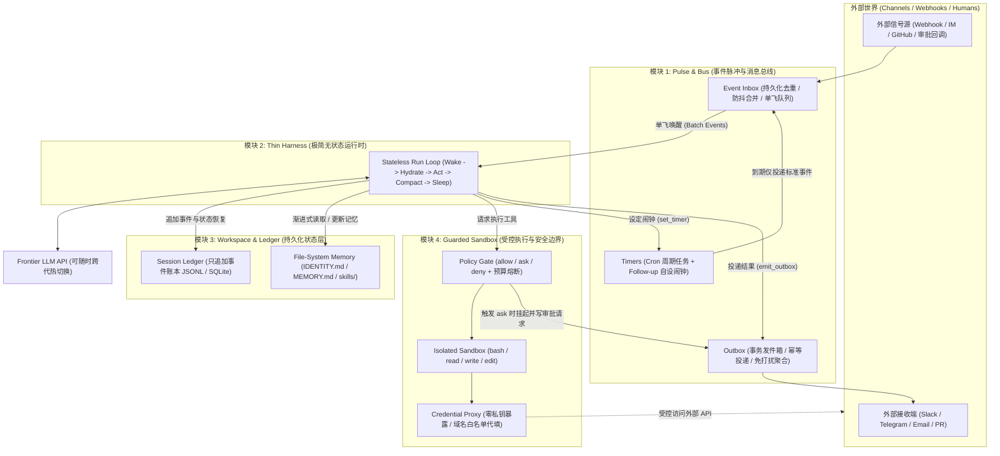

# agentd（Gemini 架构设计版）

基于 Anthropic《Building always-on agents》原语与“薄底座（Thin Harness / Bitter Lesson）”原则设计的全天候自治 Agent 守护系统。

## 设计核心理念

- **Always-On 是体验而非死循环**：99% 时间零 Token 休眠，由事件或时钟脉冲唤醒执行离散回合（Run）。
- **物理归底座，认知归模型**：底座只做时间调度、持久化账本、文件记忆、权限网关与幂等投递等“物理基础设施”；不做意图路由、固定角色编排图、重型向量切片管线等“认知脚手架”，确保底层大模型跨代升级时零重构获益。

## 本地设计文档索引（`-gemini` 后缀）

1. [系统总体架构与模块边界设计](#architecture-design)
   - 第一性原理与抗模型迭代分割线
   - 四大正交模块（`Pulse & Bus`、`Thin Harness`、`Workspace & Ledger`、`Guarded Sandbox`）职责与严格边界
   - 凌晨无人值守异步审批挂起与恢复时序
   - “反设计”清单与模型跨档升级推演矩阵
2. [参考基准与社区最佳实践调研笔记](#industry-references)
   - Anthropic《Building always-on agents》五大原语拆解
   - Anthropic《Scaling Managed Agents》脑手分离与零密钥沙箱要点
   - `Pi-coding-agent`、`OpenClaw` 与原生协议直连实践总结
3. [核心数据表、接口契约与工作区规范](#contracts-and-schemas)
   - 本地目录布局与权限红线
   - SQLite WAL 核心表结构（`inbox_events`、`timers`、`outbox_messages`、`pending_approvals`、`topic_leases`）
   - 7 个不变原子工具契约、`policy.yaml` 与 `IDENTITY.md` / `MEMORY.md` 初始模板

---

<a id="architecture-design"></a>

# Always-On Agent 系统架构设计文档（`agentd`）

> **设计基准**：Anthropic《Building always-on agents》（William Hu）+《Scaling Managed Agents: Decoupling the brain from the hands》+ 社区极简底座实践（OpenClaw / Pi-coding-agent / Bitter Lesson）
> **核心目标**：用最少的正交模块构建一套**全天候自治、崩溃可恢复、安全受控**的后台 Agent 系统，且**不会因底层大模型跨代升级而沦为技术债**。

---

## 一、第一性原理：如何设计一套“不被模型升级淘汰”的系统？

### 1.1 重新理解“Always-On（全天候在线）”
Anthropic 在《Building always-on agents》中指出了最核心的架构认知转换：**“Always-On”描述的是用户体验，而不是运行时形态。**

一个真正的全天候 Agent **99% 的时间处于休眠态（0 Token 消耗、无推理进程占用）**。它像操作系统的守护进程（Daemon）一样，仅在外部事件或内部时钟触发时醒来，在有界的会话（Session）中执行一次离散的工作回合（**Run**），持久化关键状态、投递外部动作、按需为自己设定下一次唤醒闹钟，随后立即休眠。

### 1.2 抗模型迭代的黄金分割线：物理基础设施 vs. 认知脚手架
社区过去两年的核心经验（Rich Sutton 的 **Bitter Lesson** 在 Agent 领域的映射）是：**凡是为了弥补“当前模型不够聪明”而编写的复杂控制流，都会在下一次模型跨档升级时变成阻碍模型发挥的负资产。**

因此，`agentd` 的模块划分严格遵循 **“物理归底座，认知归模型”** 的边界定律：

| 维度 | 物理基础设施层（`agentd` 必须做稳） | 认知脚手架层（坚决不建，交给模型原生能力） |
| :--- | :--- | :--- |
| **本质问题** | 解决时间流逝、断电持久化、并发竞态、密钥隔离、网络幂等 | 试图教模型“如何思考、如何拆解任务、如何检索记忆” |
| **典型形态** | 事件收件箱、持久化定时器、只追加账本、纯文本文件系统、权限沙箱、事务发件箱 | 多 Agent 编排图（DAG/状态机）、意图分类器（Intent Router）、重型向量/图记忆管线（GraphRAG）、几十个细粒度 API 包装函数 |
| **模型跨代升级后的命运** | **完全免疫且持续增值**：哪怕升级到准 AGI，进程不运行时依然无法唤醒自己，依然不能把明文私钥放进不可信执行环境 | **迅速贬值甚至反向劣化**：强推理模型会被死板的规划模板束缚，长窗口与原生检索会让复杂切片 RAG 变成精度瓶颈 |

> [!IMPORTANT]
> **架构铁律**：在 `agentd` 中新增任何代码前，必须通过一个灵魂拷问——**“如果半年后底层模型智商翻倍、上下文扩充 10 倍，这段代码还需要存在吗？”** 如果答案是否定的，不要把它写进系统模块。

---

## 二、系统全景：从“5 大原语”收敛为“4 大正交模块”

Anthropic《Building always-on agents》提出了支撑后台 Agent 的 **5 个外围原语**：`Event Inbox`、`Timers`、`Memory`、`Permissions`、`Outbox`；同时在《Scaling Managed Agents》中提出了 **Session（状态账本）- Harness（无状态控制循环）- Sandbox（隔离执行手脚）** 的三元解耦架构。

若将每个概念独立建服务，极易膨胀为 8~10 个微服务。按“状态同源与职责正交”原则，我们将整套系统极限收敛为 **4 个核心模块**（外加可热插拔的标准 LLM API）：



### 原语与模块映射表

| Anthropic 5 大原语 / 核心概念 | 归属模块 | 收敛理由（为什么这样合并最简？） |
| :--- | :--- | :--- |
| **Event Inbox（事件收件箱）** | **模块 1：`Pulse & Bus`** | Inbox、Timers、Outbox 本质上都是**围绕同一持久化事务库的消息队列与时间调度**，合并后只需一个轻量级常驻协程即可驱动全部异步收发。 |
| **Timers（定时器）** | **模块 1：`Pulse & Bus`** | Timer 到期**绝不走独立执行分支**，而是向 Inbox 插入一条标准事件，100% 复用消费链路。 |
| **Outbox（发件箱）** | **模块 1：`Pulse & Bus`** | 与 Inbox 对称的出口缓冲层，统一管理外部渠道连接器（Adapters）。 |
| **Core Reasoning Loop（推理循环）** | **模块 2：`Thin Harness`** | 纯无状态进程/协程，负责拼装上下文、调用模型、推进单次 Run 并在结束后彻底释放资源。 |
| **Memory（跨会话记忆）+ Session** | **模块 3：`Workspace & Ledger`** | 将机器恢复所需的**只追加事件账本**与人类/模型共读的**纯文本文件系统记忆**统一为唯一持久化真相源。 |
| **Permissions（权限）+ Hands** | **模块 4：`Guarded Sandbox`** | 权限只有卡在真正的**副作用执行边界（Effect Boundary）**才有物理安全性，因此将策略拦截、凭证代理与沙箱原语内聚在一处。 |

---

## 三、四大模块详细设计与严格边界

### 模块 1：`Pulse & Bus`（事件脉冲与消息总线）

* **定位**：系统的“自主神经与生物钟”。它是全系统**唯一需要 7×24 常驻监听**的轻量级组件（纯确定性 I/O 代码，零大模型调用）。
* **核心职责与内部机制**：
  1. **统一信封接入与幂等去重（Event Inbox）**：
     * 外部 Webhook、IM 消息、系统监控告警先快速落盘为统一 `EventEnvelope`（毫秒级 ACK，防止上游超时重发），基于 `(source, external_id)` 唯一索引自动去重。
  2. **突发防抖与单飞串行（Coalescing & Single-Flight Lock）**：
     * **防抖窗口（Debounce）**：例如用户在 IM 连续发送 4 条短消息，或 GitHub 短时间推送多次 Commit，支持配置 1~3 秒滑动窗口合并为单次事件批次（Batch）唤醒 Agent。
     * **单飞锁（Per-Agent / Per-Topic Lease）**：同一时刻同一个会话流只允许一个活跃 Run，彻底杜绝并发 Run 同时覆写记忆或对外发出矛盾回复。
  3. **双模持久化定时器（Timers）**：
     * 支持两类触发器：**`Schedule`（固定 Cron 周期任务，如每日巡检）** 与 **`Follow-up`（Agent 在某次 Run 中为自己设定的单次跟进闹钟，如“20 分钟后检查 CI 是否通过”）**。
     * 支持**条件自动取消（Cancel-on-Event）**：例如设定“若客户 24 小时未回复则跟进”，若客户在第 3 小时回复进入 Inbox，自动核销该 Follow-up 定时器。
     * **防自激死循环保护**：跟踪连续自动唤醒深度（`auto_hop_count`），当无外部人类交互而连续自触发超过阈值（如 10 次）时强制挂起告警。
  4. **事务发件箱与渠道投递（Outbox）**：
     * 缓存 Agent 产出的外部通知或动作，凭 `idempotency_key` 保证网络重试不重复发信；支持免打扰时段（Quiet Hours）自动积压为摘要（Digest）发送。
* **严格边界**：
  * **做什么**：收信落盘、去重防抖、定时脉冲、单飞加锁、幂等发信、渠道协议转换。
  * **绝不做什么**：**绝不做语义理解、绝不做意图路由（Intent Classification）、绝不组装 Prompt**。所有事件对它而言只是带元数据的不透明信封。

---

### 模块 2：`Thin Harness`（极简无状态运行时）

* **定位**：系统的“无状态推理引擎驱动器”。每次被 `Pulse & Bus` 唤醒时拉起一次 **Run**，处理完毕即销毁。
* **核心职责与内部机制**：
  1. **标准生命周期推进（`Wake -> Hydrate -> Loop -> Persist -> Sleep`）**：
     * **Hydrate（状态水合）**：读取 `IDENTITY.md`（身份与核心边界）+ `MEMORY.md`（核心记忆索引）+ 当前会话近期账本 + 本次触发的 Inbox 事件批次。
     * **Native Tool Loop（原生单循环）**：循环调用 `LLM API -> 解析工具调用 -> 交由 Guarded Sandbox 执行 -> 将结果追加至 Session Ledger`，直到模型判断当前回合无需继续行动。
  2. **预算级上下文管理（Context Compaction，而非截断）**：
     * 绝不粗暴丢弃早期历史（会导致遗忘核心约束）。当上下文接近阈值（如窗口的 75%）时，生成结构化 Checkpoint 摘要写入账本锚点，而完整原始记录仍保留在磁盘 `ledger` 中供模型按需检索回溯。
  3. **异步中断挂起支持（Suspend & Exit）**：
     * 当 `Guarded Sandbox` 返回 `SUSPEND_FOR_APPROVAL` 时，不阻塞等待线程，而是立即将挂起态记入账本并正常结束本次 Run（释放全部算力）。
* **严格边界**：
  * **做什么**：管理单次 Run 的上下文窗口预算、流转模型与沙箱之间的调用、处理 API 重试与单次 Run 步数/费用上限。
  * **绝不做什么**：
    * **不内置多 Agent 角色编排图**（不搞固定 Planner / Coder / Reviewer 状态机；若确需并行处理，仅提供向 Inbox 投递异步子任务的原子能力）。
    * **不注入厚重的思考套路提示词**（保持核心 System Prompt < 1,000 Tokens，把推理空间让给模型原生 Extended Thinking）。
    * **进程内存不保存任何跨 Run 状态**（崩溃后由另一实例重放账本即可无缝接管）。

---

### 模块 3：`Workspace & Ledger`（持久化状态层）

* **定位**：系统的“海马体与长期工作台”，全系统唯一的持久化状态真相源（Single Source of Truth）。
* **核心职责与双层存储结构**：
  1. **Session Ledger（机器真相源：只追加事件账本）**：
     * 以 Append-Only 方式记录每一次事件流入、模型消息、工具入参/出参、审批状态变更及压缩锚点（SQLite 表或按会话分片的 `.jsonl`）。保证任何时间点可精确审计与断点续跑。
  2. **File-System Memory（认知真相源：纯文本目录树，抛弃重型向量库）**：
     * 吸收 `OpenClaw`、`Claude Code` 与 `Pi` 的核心经验：**用人类可读、Git 可版本化的 Markdown 文件树替代黑盒 Vector DB / GraphRAG**。
     * 遵循 Anthropic《Building always-on agents》的记忆原则：**只存储模型无法从外部系统实时重查的提炼认知、用户偏好与状态指针，绝不把外部业务系统数据全量同步进记忆里。**
     * **渐进式披露（Progressive Disclosure）分层**：
       * **L0 常驻层（每次 Run 自动注入，严格限长）**：`IDENTITY.md`（职责边界、沟通风格）、`MEMORY.md`（不超过 200 行的全局记忆索引表与活跃事项指针）。
       * **L1 按需层（模型按需 `read`/`grep`）**：`notes/`（历史项目档案、深度调研记录）、`skills/`（特定工具/API 的使用手册与脚本，仅在用到时由模型自行翻阅，避免预加载几十个 MCP Schema 撑爆上下文）。
* **严格边界**：
  * **做什么**：保证账本原子追加写入、提供干净透明的文件目录结构与 Git 快照备份能力。
  * **绝不做什么**：**不建复杂的后台知识图谱抽取管线、不强依赖黑盒 Embedding 召回器**（在个人/团队级 Always-On Agent 规模下，`MEMORY.md` 索引 + 原生 `ripgrep` 精确检索 + 按需全文阅读的准确率与可维护性远超切片向量检索；即使未来数据量极大，也仅作为一个可选的 CLI 搜索工具挂入沙箱，而不侵入核心架构）。

---

### 模块 4：`Guarded Sandbox`（受控执行与安全边界）

* **定位**：系统的“隔离手脚与确定性免疫系统”。践行 **“模型提出建议，底座裁决执行（The Model Proposes; The Harness Disposes）”**。
* **核心职责与内部机制**：
  1. **极简原生动作空间（7 个原子工具契约）**：
     * 拒绝封装几十个易碎的高层业务包装函数，只给模型提供它在预训练中早已烂熟于心的底层原语：
       * **环境操作 4 原语**：`bash`（运行 CLI、`curl`、`gh`、`jq`、自编写一次性脚本）、`read_file`、`write_file`、`edit_file`。
       * **系统交互 3 原语**：`set_timer`（创建/取消 Follow-up 或周期任务）、`emit_outbox`（对外发消息或交付产物）、`request_approval`（遇到模糊高优决策时主动向人发起确认）。
  2. **确定性策略网关（Deterministic Policy Gate）**：
     * 用确定性代码（而非系统提示词）拦截每次工具调用与高危操作，划分为三级策略：
       * `allow`：只读操作、工作区内草稿读写、白名单查询命令，自动静默执行。
       * `ask`：对外发送正式邮件/PR、修改生产资源、超出阈值开销的操作，触发**异步挂起审批流**。
       * `deny`：破坏宿主机边界、访问黑名单路径/域名的行为，直接硬拦截并将拒绝原因返回给模型自行调整方案。
     * 内置**硬性熔断器**：单次 Run 最大工具步数、单日累计 Token 预算硬上限。
  3. **零密钥沙箱与凭证代填代理（Credential Isolation Proxy）**：
     * 采纳 Anthropic *Managed Agents* 核心安全架构：**沙箱容器/子进程环境变量中绝不存放真实的第三方 API Key / Token**。
     * 当沙箱内通过 HTTP 代理或受控网关访问 GitHub / Slack / 云厂商 API 时，由宿主机边界层的 `Credential Proxy` 校验目标域名与权限范围（Scope）后动态注入认证头。即便模型遭遇外部网页/邮件的 Prompt Injection 攻击，攻击者也无法通过 `env` 或读取内存窃取任何凭证。
* **严格边界**：
  * **做什么**：进程/容器级隔离执行、代码级权限策略裁决、凭证隔离代填、资源与超时控制。
  * **绝不做什么**：**不在工具层替模型做异常兜底启发式逻辑**（工具报错时原样返回清晰 stderr/状态码，让模型自己看报错并自我修复）。

---

## 四、关键交互时序：常规唤醒与凌晨无人值守审批流

Always-On Agent 最容易踩坑的场景是**后台无人值守时遇到高权限动作**（传统交互式 Agent 会直接卡死在终端确认框）。以下时序展示了 4 大模块如何通过纯异步事件流优雅闭环：

```mermaid
sequenceDiagram
    autonumber
    participant Ext as 外部系统 / 人类
    participant Bus as 模块1: Pulse & Bus
    participant Run as 模块2: Thin Harness
    participant State as 模块3: Workspace & Ledger
    participant Box as 模块4: Guarded Sandbox
    participant LLM as Frontier LLM

    Note over Bus,Box: 阶段一：凌晨 03:00 定时器触发巡检，零人工在场
    Bus->>Bus: Timer 到期，向 Inbox 写入 timer.fired 事件
    Bus->>Run: 获取单飞锁，唤醒 Run #101 (携带事件)
    Run->>State: 读取 IDENTITY.md + MEMORY.md + 近期账本
    Run->>LLM: 注入上下文与事件，开始推理
    LLM-->>Run: 调用 bash (只读检查日志与指标)
    Run->>Box: 执行 bash
    Box-->>Run: Policy=allow，通过代理执行并返回异常报告
    Run->>LLM: 反馈检查结果
    LLM-->>Run: 决定执行修复操作 (触发高危写权限命令)
    Run->>Box: 请求执行修复动作
    Box-->>Run: Policy=ask (拦截！生成 approval_id=ap_88)
    Run->>State: 账本记录 SUSPENDED_FOR_APPROVAL (保存待执行调用)
    Run->>Bus: 向 Outbox 写入审批请求卡片 + 设定 12h 超时 Follow-up Timer
    Run->>Bus: 释放单飞锁，Run #101 退出销毁 (恢复 0 Token 休眠)
    Bus->>Ext: Outbox 投递审批通知至用户 IM

    Note over Bus,Box: 阶段二：上午 09:15 人类在手机端点击“批准”
    Ext->>Bus: Webhook 回调写入 Inbox (approval.resolved: ap_88=approved)
    Bus->>Bus: 自动核销 ap_88 关联的 12h 超时跟进闹钟
    Bus->>Run: 获取单飞锁，唤醒 Run #102
    Run->>State: 从账本恢复挂起现场与已获批凭证令牌
    Run->>Box: 凭单次批准票据执行原修复动作
    Box-->>Run: 执行成功，返回结果
    Run->>LLM: 汇总结果并收尾
    LLM-->>Run: 更新 MEMORY.md + 调用 emit_outbox 汇报修复完成 + set_timer(30m 后复查指标)
    Run->>State: 落盘记忆与账本
    Run->>Bus: 提交 Outbox 与 30m 复查闹钟，释放单飞锁休眠
    Bus->>Ext: 推送完成简报
```

---

## 五、“反设计”清单与模型跨代升级演进验证

### 5.1 明确砍掉的 6 个常见模块（Anti-Patterns）

1. **不建 Intent Router（前置意图分类模块）**：不要用小模型或正则先把 Inbox 事件分成“日程类/代码类/问答类”再分发给不同子工作流——直接交给主模型统一判断。
2. **不建固定 Multi-Agent 角色网（Planner / Executor / Critic 图编排）**：单模型原生多步工具循环已远强于人为拆分的传话筒链路，且省去多智能体间的上下文损耗。
3. **不建重型 Vector DB 记忆中间件**：在成千上万条笔记规模内，维护良好的 `MEMORY.md` 目录索引 + 文件系统 `ripgrep` 检索比向量切块召回更准、零幻觉拼接、且人类随时可直接打开编辑器修正。
4. **不建预加载全量工具 Schema 注册中心**：不在 System Prompt 里塞入 50 个 MCP 工具定义；保持 7 个核心原语不变，外部能力通过 CLI + `skills/*.md` 按需阅读调用。
5. **不建复杂的异常自愈状态机**：不要在底座写“若命令退出码为 X 则自动执行 Y”的脆弱规则，把报错信息原样喂回模型即可。
6. **不建基于 Prompt 的安全防线**：不靠在系统提示词里写十条“绝对不要删除生产数据”来控权，权限控制全部收敛在 `Guarded Sandbox` 的确定性代码网关中。

### 5.2 当模型发生跨档跃迁时，`agentd` 各模块受影响推演

| 模型跨代升级带来的能力跃迁 | 传统重型 Agent 框架的痛点 | `agentd` 四模块架构的表现（需要改什么？） |
| :--- | :--- | :--- |
| **上下文窗口扩充 10x 且缓存成本骤降** | 复杂的切片 RAG 与多层摘要管线成为信息有损瓶颈，重构成本高 | **零架构改动**：仅在 `Thin Harness` 中调大 `compaction_threshold` 配置项，直接吃满原生超长上下文红利。 |
| **长程自主规划与复杂推理跨档升级** | 原先写死的 Planner-Subagent DAG 状态机反而限制模型动态调整路径 | **零代码改动**：因为 `Thin Harness` 是无预设套路的原生单循环，换上新模型 API Key 当天即可获得跨档规划能力。 |
| **原生工具自编写 / Computer Use 能力跃升** | 数十个手工封装的专用 Python API Tool 维护过时、参数僵化 | **零工具重构**：`Guarded Sandbox` 暴露的是底层 `bash` 与文件原语，更强的模型会自动编写更精妙的脚本和 CLI 组合完成任务。 |
| **模型的主动判断力与时间感显著增强** | 固定写死在代码里的业务轮询逻辑无法灵活适应复杂跟进节奏 | **直接释放潜能**：模型会更聪明地自主调用 `set_timer` 决定何时跟进、何时保持安静（不打扰用户），`Pulse & Bus` 原封不动。 |

---

<a id="industry-references"></a>

# 参考基准与社区最佳实践调研笔记

本文档沉淀 `agentd` 架构设计背后的核心文献与开源社区最佳实践依据，作为后续演进时的决策参考。

---

## 一、Anthropic《Building always-on agents》核心要点拆解

* **来源**：`https://claude.com/resources/articles/building-always-on-agents`（作者：William Hu，Anthropic Applied AI）
* **核心论断**：
  1. **“Always-On”是体验而非持续推理进程**：Agent 绝大部分时间处于休眠状态（零成本），仅在触发时拉起一次离散的 **Run**。底层推理循环与普通 Agent 并无二致，真正的差异在于**外围支撑生命周期的 5 个原语**。
  2. **为什么现在可行**：前沿模型判断力（何时自主推进 vs. 何时打扰人类）提升 + Token 成本大幅下降，使跨天/跨周的后台自治在经济和可靠性上同时成立。

### 五大基础设施原语及设计避坑点

| 原语 | 解决的核心故障 | 关键工程要求 |
| :--- | :--- | :--- |
| **1. Event Inbox** | 外部 Webhook 直接触发 Agent 会导致并发 Run 踩踏、状态覆盖及崩溃丢消息 | 先快速写入持久化表并 ACK；Worker 串行拉取；按源事件 ID 幂等去重；突发高频消息做合并批处理 |
| **2. Timers** | Agent 无法仅靠被动响应实现跟进（如等待 CI 结果、等待对方回信） | 区分固定周期 `Schedules` 与 Agent 自设单次 `Follow-ups`；到期后**统一向 Event Inbox 投递事件**，不另起执行分支 |
| **3. Memory** | 休眠后上下文清空导致跨 Run 失忆；或把所有外部数据塞进记忆导致陈旧失真 | 持久化层独立于 Worker 生命周期；**只存无法从外部系统实时重查的认知、偏好与指针** |
| **4. Permissions** | 无人值守时弹窗无人点导致死锁，或放开权限导致越权与密钥泄露 | 凭证代理隔离（不把私钥给模型环境）+ 策略分级 + 需要人工授权的动作采用**延迟调用（Deferred Tool Calls）**异步恢复 |
| **5. Outbox** | 运行中频繁零碎发通知造成打扰，或网络重试导致重复执行外部写操作 | 统一收集出口消息与动作，做幂等投递、免打扰控制与批量汇总 |

---

## 二、Anthropic《Scaling Managed Agents: Decoupling the brain from the hands》

* **核心痛点诊断**：传统“宠物容器（Pet Container）”把推理循环、会话状态、代码沙箱绑在同一个容器里，不仅冷启动慢、单点脆弱，而且**Harness 往往写死了针对某一代模型缺陷的补丁逻辑**，一旦模型升级就会变成负累。
* **三大解耦原则（类比操作系统虚拟化）**：
  1. **Session（持久化只追加事件日志）独立于上下文窗口**：Session Log 是唯一的真相源（Source of Truth），上下文窗口只是对 Session Log 的投影视图。
  2. **Harness（大脑驱动循环）完全无状态**：随时可水平扩缩或崩溃重启，重连 Session Log 即可恢复。
  3. **Sandbox（手脚执行环境）当成可随时销毁的“牲畜（Cattle）”**：对大脑而言，沙箱只是一个 `execute(tool, input) -> output` 接口；同时**敏感密钥绝不进入沙箱内部**，统一由边界层代理注入。

---

## 三、社区极简底座运动与“苦涩的教训（The Bitter Lesson）”

### 3.1 `Pi-coding-agent`（Mario Zechner）：极简 Harness 范式
* **核心主张**：主流商业 Agent 往往内置上万 Token 的私有提示词、强制 Plan 模式、内置子智能体树与预加载 MCP 列表，这些“过度脚手架（Over-scaffolding）”在模型升级时反而干扰模型原生训练分布。
* **极简实践**：
  * 系统提示词 + 工具定义总计 **< 1,000 Tokens**。
  * 只保留 **4 个基础文件与终端工具**：`read`、`write`、`edit`、`bash`。
  * 会话采用完全透明可检视的 `.jsonl` 树存储，零暗箱注入。

### 3.2 `OpenClaw`：本地守护进程与纯文本工作区范式
* **核心主张**：将 Always-On Agent 视为常驻网关守护进程（Gateway Daemon），连接多端消息通道与定时心跳。
* **极简实践**：
  * **Markdown-as-Memory/Config**：不把身份、规则、记忆藏在复杂的数据库 Schema 或 Python 类里，而是直接存为工作区下的纯文本文件（如 `IDENTITY.md`、`MEMORY.md`、`skills/*.md`），人类与模型共用同一套可读可编辑视图。

### 3.3 原生协议直连趋势（Raw Primitives over Heavy Wrappers）
* **经验总结**：与其给模型封装 50 个脆弱的专用 Python 工具函数（例如针对某个网站的点击包装器或阉割版 GitHub API 包装器），不如直接暴露底层标准 CLI（如 `gh`、`curl`、`jq`）或原始协议（如浏览器 CDP），配合按需查阅的简短 Markdown 技能说明。因为前沿模型在预训练阶段已深度学习过标准协议与 Unix 工具链，能够原生组合脚本并自主根据报错恢复。

---

<a id="contracts-and-schemas"></a>

# 核心数据表、接口契约与工作区规范（实现蓝图）

本文档定义 `agentd` 单机生产原型的落地规格，包含目录布局、SQLite 表结构、7 个原子工具契约与策略配置模板。

---

## 一、本地运行目录标准布局

```text
agentd/
├── docs/                       # 项目架构与设计文档（当前目录）
├── src/                        # 核心守护进程源码（模块 1~4，目标控制在 < 2000 行）
├── data/                       # 运行时持久化目录（位于沙箱可写边界之外！）
│   ├── state.db                # SQLite (开启 WAL 模式)：Inbox / Timers / Outbox / Approvals
│   ├── policy.yaml             # 确定性权限策略与预算配置（沙箱不可修改）
│   └── ledger/                 # 按 topic_key 分片的只追加会话账本 (*.jsonl)
└── workspace/                  # Agent 专属工作区（独立 Git 仓库，沙箱可受控读写）
    ├── IDENTITY.md             # [L0 常驻注入] 身份定义、职责范围、沟通准则 (< 500 tokens)
    ├── MEMORY.md               # [L0 常驻注入] 核心长期记忆索引与活跃事项指针 (< 1500 tokens)
    ├── skills/                 # [L1 按需读取] 外部系统操作说明与脚本约定 (*.md)
    ├── notes/                  # [L1 按需读取] 项目档案、排查纪要、归档知识
    └── scratch/                # [L2 临时草稿] 一次性分析脚本与临时数据文件
```

---

## 二、SQLite 核心表结构（`data/state.db`）

初始化时统一开启：`PRAGMA journal_mode = WAL; PRAGMA busy_timeout = 5000;`

```sql
-- 1. 事件收件箱（模块 1: Event Inbox）
CREATE TABLE IF NOT EXISTS inbox_events (
    id              TEXT PRIMARY KEY,              -- ULID (按时间字典序递增)
    dedup_key       TEXT UNIQUE NOT NULL,          -- 幂等键，如 "github:delivery_xxx" 或 "timer:t_01:173000"
    topic_key       TEXT NOT NULL DEFAULT 'main',  -- 会话隔离键（同一 topic 严格单飞串行）
    source          TEXT NOT NULL,                 -- 事件源：telegram | webhook | timer | approval | subrun
    event_type      TEXT NOT NULL,                 -- 事件类型：message.created | timer.fired | approval.resolved
    payload_json    TEXT NOT NULL,                 -- 标准化 JSON 载荷
    auto_hop_count  INTEGER NOT NULL DEFAULT 0,    -- 连续自触发计数（人类消息重置为 0，防无限自激循环）
    status          TEXT NOT NULL DEFAULT 'pending', -- pending | processing | done | dead
    available_at    INTEGER NOT NULL,              -- Unix ms，用于防抖窗口（Debounce）延迟消费
    created_at      INTEGER NOT NULL
);
CREATE INDEX IF NOT EXISTS idx_inbox_ready ON inbox_events(status, topic_key, available_at);

-- 2. 持久化定时器（模块 1: Timers）
CREATE TABLE IF NOT EXISTS timers (
    id                       TEXT PRIMARY KEY,
    topic_key                TEXT NOT NULL DEFAULT 'main',
    kind                     TEXT NOT NULL,        -- 'cron' (周期) | 'followup' (单次跟进)
    cron_expr                TEXT,                 -- 仅 kind='cron' 时必填，标准 5 段表达式
    fire_at                  INTEGER NOT NULL,     -- 下次触发时间 Unix ms
    prompt_payload           TEXT NOT NULL,        -- 唤醒时注入给 Agent 的提醒内容与上下文指针
    cancel_on_topic_activity INTEGER NOT NULL DEFAULT 0, -- 若为 1，该 topic 收到外部人类回复时自动取消
    auto_hop_count           INTEGER NOT NULL DEFAULT 1,
    status                   TEXT NOT NULL DEFAULT 'active', -- active | fired | cancelled
    created_at               INTEGER NOT NULL
);
CREATE INDEX IF NOT EXISTS idx_timers_due ON timers(status, fire_at);

-- 3. 事务发件箱（模块 1: Outbox）
CREATE TABLE IF NOT EXISTS outbox_messages (
    id              TEXT PRIMARY KEY,
    idempotency_key TEXT UNIQUE NOT NULL,          -- 防止重试时重复外发消息
    channel         TEXT NOT NULL,                 -- telegram | slack | feishu | email | webhook
    target          TEXT NOT NULL,                 -- 目标会话或接收地址
    kind            TEXT NOT NULL DEFAULT 'message', -- message | approval_card | digest
    content_json    TEXT NOT NULL,                 -- 渠道无关的结构化消息体
    deliver_after   INTEGER NOT NULL,              -- Unix ms（免打扰时段可推迟到次日早晨投递）
    status          TEXT NOT NULL DEFAULT 'queued', -- queued | sending | sent | failed
    retry_count     INTEGER NOT NULL DEFAULT 0,
    last_error      TEXT,
    created_at      INTEGER NOT NULL
);
CREATE INDEX IF NOT EXISTS idx_outbox_queue ON outbox_messages(status, deliver_after);

-- 4. 异步权限审批单（模块 4 联动 模块 1/2）
CREATE TABLE IF NOT EXISTS pending_approvals (
    id              TEXT PRIMARY KEY,
    topic_key       TEXT NOT NULL,
    run_id          TEXT NOT NULL,
    tool_name       TEXT NOT NULL,
    tool_args_json  TEXT NOT NULL,
    reason          TEXT NOT NULL,                 -- 触发审批的规则说明或 Agent 附言
    status          TEXT NOT NULL DEFAULT 'waiting', -- waiting | approved | rejected | expired
    decided_by      TEXT,
    decided_at      INTEGER,
    expires_at      INTEGER NOT NULL,
    created_at      INTEGER NOT NULL
);

-- 5. 单飞运行租约锁（防止多 Worker 或异常重入并发执行同一 topic）
CREATE TABLE IF NOT EXISTS topic_leases (
    topic_key       TEXT PRIMARY KEY,
    run_id          TEXT NOT NULL,
    lease_until     INTEGER NOT NULL               -- 心跳续租时间戳，进程崩溃超时自动释放
);
```

---

## 三、暴露给大模型的 7 个不变原子工具契约

始终只向模型注入这 7 个精简 Schema（总计约 600 Tokens），不随业务增长而膨胀：

| 类别 | 工具名 | 参数概览 | 权限默认策略 |
| :--- | :--- | :--- | :--- |
| **环境原语** | `bash` | `command: string, timeout_ms?: number, cwd?: string` | 按命令匹配 `policy.yaml`（只读 `allow` / 写外部 `ask` / 越界 `deny`） |
| **环境原语** | `read_file` | `path: string, start_line?: number, end_line?: number` | `workspace/` 内默认 `allow` |
| **环境原语** | `write_file` | `path: string, content: string` | `workspace/` 内默认 `allow`；外部路径 `deny` |
| **环境原语** | `edit_file` | `path: string, old_text: string, new_text: string` | `workspace/` 内默认 `allow`；外部路径 `deny` |
| **生命周期原语** | `set_timer` | `action: "create"\|"cancel"\|"list", kind?: "followup"\|"cron", delay_seconds?: number, cron_expr?: string, prompt?: string, cancel_on_reply?: boolean, timer_id?: string` | `allow`（受活跃 Timer 总数与最小间隔硬限制约束） |
| **生命周期原语** | `emit_outbox` | `channel: string, target: string, message: string, urgent?: boolean` | 对已绑定主用户通知默认 `allow`；对外部第三方发信默认 `ask` |
| **生命周期原语** | `request_approval` | `summary: string, proposed_action: string, expires_in_hours?: number` | `allow`（直接触发挂起并向主用户投递确认卡） |

---

## 四、`data/policy.yaml` 确定性安全策略示例

```yaml
budgets:
  max_steps_per_run: 30              # 单次唤醒最多工具步数
  max_tokens_per_day: 2000000        # 每日累计 Token 熔断上限
  max_auto_hops: 8                   # 无人工介入最多连续自唤醒次数
  min_followup_seconds: 30           # 防止设置 1 秒死循环闹钟

quiet_hours:
  timezone: "Asia/Shanghai"
  window: "23:00-08:00"              # 非 urgent 的 Outbox 消息延迟至 08:00 汇总发送

filesystem:
  writable_roots:
    - "./workspace"
  denied_paths:
    - "./data"                       # 严禁沙箱读写账本库与策略文件本身
    - "~/.ssh"
    - "~/.aws"

bash_rules:
  deny_patterns:
    - "rm -rf /"
    - "mkfs"
    - "sudo "
  ask_patterns:
    - "gh pr merge"
    - "git push"
    - "kubectl delete"
    - "kubectl apply"
  default: "allow"                   # 沙箱受限用户下其余命令放行

egress_proxy:
  inject_credentials:
    - domain: "api.github.com"
      header: "Authorization"
      secret_env: "HOST_GITHUB_TOKEN" # 仅宿主机代理进程可读，沙箱内不可见
      allowed_methods: ["GET", "POST"]
```

---

## 五、工作区初始文件模板

### `workspace/IDENTITY.md` 模板
```markdown
# Identity & Operating Rules

你是运行在 `agentd` 上的全天候自治代理。

## 工作原则
1. 你在离散的事件唤醒（Run）中工作：每次醒来先看触发事件与 `MEMORY.md`，完成闭环后干脆地结束回合进入休眠。
2. 保持安静克制：例行巡检若一切正常，仅记录状态，**不要调用 `emit_outbox` 打扰用户**；仅在发现异常、达成里程碑或需要决策时汇报。
3. 需要等待外部异步结果（如 CI 构建、对方回信）时，不要在 `bash` 中 `sleep` 死等，调用 `set_timer` 设定 `followup` 闹钟后立即结束当前回合。
4. 遇到 `workspace/skills/` 中已记录的系统能力，先按需 `read_file` 阅读对应技能说明再执行。
```

### `workspace/MEMORY.md` 模板
```markdown
# Long-Term Memory Index

> 维护准则：本文件每次唤醒自动加载，严格保持在 200 行以内。只记录提炼结论、用户偏好与指向 `notes/` 的索引指针；外部系统可实时查询的状态不要复制到此处。

## 用户偏好与沟通约定
- （待沉淀）

## 当前跟进中的跨周期事项（Active Threads）
- （暂无活跃事项）

## 知识档案索引（Notes Index）
- 详见 `notes/` 目录
```
