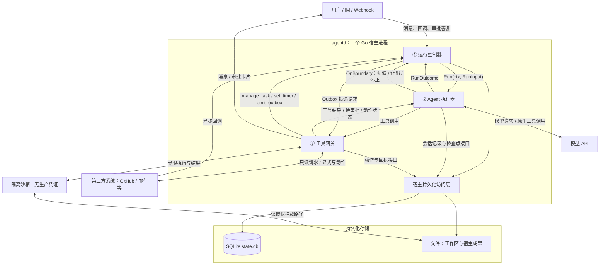
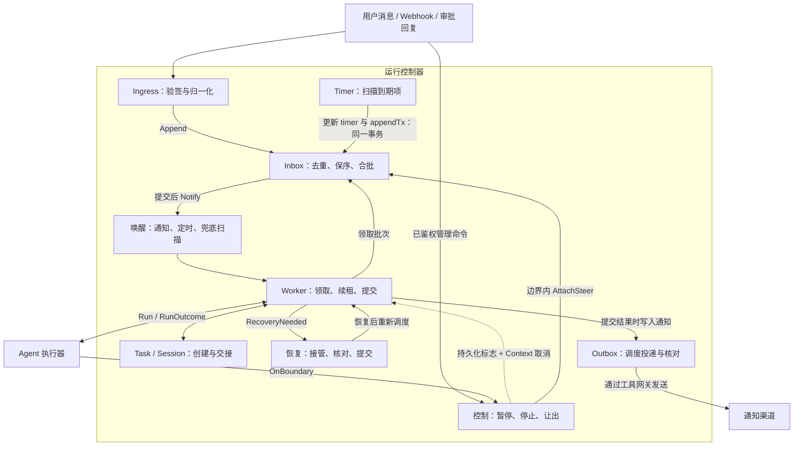
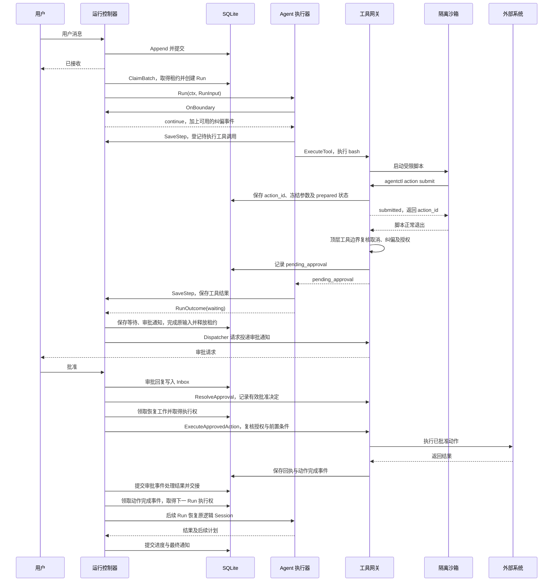

# agentd 系统架构与模块接口

agentd 面向个人或小团队的长期后台任务，采用三个核心模块、一个 Go 宿主进程、一套持久化存储，以及独立执行沙箱。事件驱动有限 Run，任务、会话与动作记录跨 Run 保留。

本文是架构总览，依据 [README 架构解析](../design/00-background-always-on-agents.md)、[最新版系统设计](always-on-agent-design-codex-latest.md) 和 [Event Inbox Go 实现设计](event-inbox-design-codex.md)。图中的内部方框表示代码职责，不代表独立微服务。接口示例属于设计契约，不表示代码已经实现。

**1 整体模块与接口**



运行控制器决定何时执行、恢复哪段工作；执行器决定如何完成目标；工具网关决定提出的动作能否执行，并记录执行结果。

模型不直接取得宿主权限。沙箱没有数据库直写权和生产凭证，不能通过脚本绕过宿主修改任务状态或执行外部写操作。沙箱可通过受控 CLI/IPC 调用网关，图中的受限执行通道包含这类请求。

持久化访问层是内部函数和事务封装，不是第四个业务模块。图中 Files 是逻辑统称：普通笔记、草稿位于可受控访问的工作区，生效指令和 Skills 对 Agent 只读，宿主成果快照与大输出文件仅通过授权引用读取。

**2 五个原语如何映射到三个模块**

| README 原语 | 具体归属 | 主要职责 |
| --- | --- | --- |
| Event Inbox | 运行控制器 | 接收、去重、顺序、合批、领取与事件恢复 |
| Timers | 运行控制器 | 持久化计划，到期转化为 Inbox 事件 |
| Memory | 文件与 SQLite 存储，执行器通过受控接口使用 | 长期指令、笔记、进度与会话连续性 |
| Permissions | 工具网关，控制器协同审批恢复 | 授权、凭证隔离、审批绑定、动作执行 |
| Outbox | 控制器调度，网关执行投递 | 可靠通知、节奏控制、投递回执 |

Memory 不独立成服务；Permissions 不只是一段提示词；Outbox Dispatcher 不绕过工具网关直接使用写凭证。单活跃 Run 限制业务推理与任务变更，并不禁止 HTTP 接入、通知投递和心跳协程并发运行。

**3 运行控制器内部结构**



Worker 的主链路是：ClaimBatch 判断是否可执行 → 加载任务和 Session → 调用 AgentRunner → 事务提交结果。不存在就绪事件时，根据 NextWakeAt、唤醒通知或兜底扫描继续等待。

OnBoundary 由控制器统一处理：检查暂停、租约与抢占，按需将新消息附加到当前 Session。它是当前执行器的回调，不是第二个并行消费者。长调用中的取消由独立控制协程触发，不必等待边界回调返回。

Inbox 细节以专门设计为准：同 order_key 不越过未完成前序，priority 只决定不同就绪流之间的选择，failure_count 只记故障。过期 Run 按三步恢复：BeginRecovery 接管事务 → 事务外核对并续租 → FinishRecovery 提交事务。ClaimBatch 只返回 RecoveryNeeded，不在领取事务中调用远端服务。

**4 模块接口清单**

| 调用方 → 接收方 | 接口或操作 | 传入 | 返回及效果 |
| --- | --- | --- | --- |
| 渠道适配器 → 控制器 | Append | 验证后的 Envelope | event_id、是否首次插入；提交后 ACK |
| Scheduler → Inbox | appendTx | timer 发生事件、当前事务 | 与 timer 更新原子提交 |
| Worker → Inbox Store | ClaimBatch | 工作空间、owner | ClaimResult：批次、NextWakeAt 或恢复提示 |
| Worker → 执行器 | AgentRunner.Run | Context、RunInput | RunOutcome |
| 执行器 → 控制器 | OnBoundary | 绑定当前 Claim 的上下文 | continue/yield/stop 与新事件 |
| 执行器 → 控制器 | SaveStep | 稳定步骤 ID、会话记录或工具结果 | 幂等追加；失败则停止推进并进入恢复 |
| 执行器 → 模型适配器 | Generate | 上下文、工具定义和预算 | 模型响应及原生工具调用 |
| 执行器 → 工具网关 | 工具调用入口 | 工具名、参数、宿主执行上下文 | 结果、拒绝、待审批或动作引用 |
| 网关 → 控制器 | manage_task | 创建、更新或关联请求 | Task ID、版本、Session 关联 |
| 网关 → 控制器 | set_timer | 任务、触发时间、周期或取消请求 | timer ID 与状态 |
| 网关 → 控制器 | emit_outbox | 接收目标、消息与关联信息 | 持久化通知 ID，不代表已经送达 |
| 沙箱 → 工具网关 | ReadExternal | Run 令牌、固定服务及受限查询 | 只读凭证代填后的查询结果 |
| 沙箱 → 工具网关 | FetchPublic | Run 令牌、受策略约束的 URL | 限额抓取结果或拒绝 |
| 沙箱 → 工具网关 | agentctl action submit/status/continue | 命名写动作、参数或 action ID | 动作状态和回执引用 |
| Worker → Store | CommitOutcome | Claim、本轮结果 | 原子保存进度并完成已消费输入 |
| Dispatcher → 网关 | 通知发送操作 | outbox ID、目标、冻结内容 | 发送回执或 unknown |
| 控制器 → 网关 | ResolveApproval | 已鉴权审批事件或到期事件引用 | 幂等记录批准、拒绝或过期决定；不发送外部请求 |
| 控制器 → 网关 | ExecuteApprovedAction | 当前执行权、action ID | 复核持久化批准记录，执行冻结动作或返回已存结果 |
| 恢复控制器 → 网关 | ReconcileAction | 当前恢复执行权、action ID | 事务外查询远端事实；不能确认则保留 unknown |

总体设计中的 RunResult 与 Inbox 设计中的 RunOutcome 表示同一个概念。实现时统一命名为 RunOutcome，不建立两套返回对象。下文给出建议的 Go 接口名；它们是待实现的契约，领域类型和错误定义仍需补全。

```go
// internal/controller：消费方接口，省略 import。
type AgentRunner interface {
    Run(ctx context.Context, input executor.RunInput) (executor.RunOutcome, error)
}

// 以下类型定义在 internal/executor，省略领域类型定义。
type RunInput struct {
    Authority  gateway.ExecAuthority // 宿主赋予的身份，不接受模型自报。
    Task       *TaskSnapshot // 可空，允许处理尚未关联任务的消息。
    Session    SessionSnapshot
    Events     []InputEvent
    Budget     Budget
    OnBoundary BoundaryHook
    SaveStep   func(context.Context, SessionStep) error
}

type BoundaryHook func(ctx context.Context) (Directive, []InputEvent, error)
```

RunInput、RunOutcome、InputEvent、TaskSnapshot、SessionSnapshot、Budget、SessionStep、Directive 和 BoundaryHook 均归 executor。controller 保留数据库记录类型 Event、Claim；调用 Run 或返回边界事件前转换为只读输入视图，保留稳定 event_id、顺序和任务关联，不向执行器暴露数据库领取状态或写权限。executor 不导入 controller；Inbox 文档采用相同类型约定。

Context 控制本地执行期限与取消，不能代替持久化权限校验。run_id、epoch、用户身份及有效权限由宿主绑定到调用上下文，模型不能通过填写参数获得其他任务的执行权。

task=nil 时可直接回答普通消息或通过 manage_task 建单；bind 已有 Task 时保存交接，在工具边界切换 Run 并恢复目标 Session，不静默替换当前对话历史。

SaveStep 由控制器绑定当前执行权。模型响应与待执行工具调用先持久化，再调用工具，工具结果随后增量追加；不能等 Run 返回时才保存整段历史。步骤使用稳定 ID 去重，并区分调用已登记、执行结果已记录。工具调用记录不能代替 Action 回执；崩溃后缺失结果时先核对动作账本，不直接重放副作用。

```go
// internal/gateway：执行权限和宿主能力的消费方契约。
type ExecAuthority struct {
    WorkspaceID, OwnerID, RunID, SessionID, ActorID string
    Epoch int64
    TaskID *string
}

type ToolCall struct {
    CallID, Name string
    Args json.RawMessage
}

type ToolResult struct {
    Output string                  // 有界预览；大输出使用受控引用。
    OutputRef *OutputRef
    PendingApproval *ApprovalTicket
    TaskChanged *TaskTransition
    IsError bool
}

// 由 executor 消费；方法实现位于 gateway。
type ToolGateway interface {
    ExecuteTool(context.Context, ExecAuthority, ToolCall) (ToolResult, error)
}

// 定义在 gateway，由 controller 实现并在启动时注入。
type HostStateMutator interface {
    ManageTask(context.Context, ExecAuthority, ManageTaskReq) (ManageTaskResp, error)
    MutateTimer(context.Context, ExecAuthority, TimerMutationReq) (TimerMutationResp, error)
    EnqueueOutbox(context.Context, ExecAuthority, OutboxEnqueueReq) (string, error)
}

// 由 controller 的 Dispatcher 消费；实际发送实现位于 gateway。
type NotificationSender interface {
    Deliver(context.Context, DeliveryAuthority, OutboxRef) (DeliveryReceipt, error)
}

// 控制器调用，实现在 gateway；审批决定与实际执行分开。
type ActionCoordinator interface {
    ResolveApproval(context.Context, ApprovalDecisionRef) (ActionRecord, error)
    ExecuteApprovedAction(context.Context, ExecAuthority, ActionID) (ActionRecord, error)
    ReconcileAction(context.Context, ExecAuthority, ActionID) (ActionRecord, error)
}
```

ApprovalDecisionRef 指向宿主已持久化的审批回复或到期事件；ResolveApproval 校验身份、关联、内容版本和期限，并以条件更新防止批准、拒绝、到期事件相互覆盖。模型不能凭自报的 approved 字段授权。记录决定不发起外部动作，因此暂停期间也可处理。重复决定复用结果；最终拒绝或过期状态与去重结果事件在同一事务中保存。

ExecuteApprovedAction 复用当前工作空间执行权，检查持久化审批、冻结内容、当前权限和资源前置条件，原子领取动作并消费批准记录；调用方法本身不授予批准。重复调用查询既有结果，executing 或 unknown 进入核对，不再次发送。ReconcileAction 复用 BeginRecovery 取得的新 owner/epoch，由网关验证恢复范围；远端查询在事务外进行，期间续租，证据和结果由宿主短事务保存。核对只查询事实，不隐含重试写操作；恢复控制器再以 FinishRecovery 提交任务恢复状态，旧执行权不能覆盖新状态。

宿主状态接口按稳定请求键幂等处理，复核权限、任务版本和预算。EnqueueOutbox 只登记投递意图；任务交付通知由 CommitOutcome 在保存成果引用和任务状态的同一事务中入队。已有 outbox ID 不代表外部已经发送成功。

Dispatcher 独立于模型 Run 运行，DeliveryAuthority 绑定通知领取凭据及投递代次，不借用已结束 Run 的 epoch。网关发送前核验领取权、暂停状态、目标授权和冻结内容，按稳定投递键保存发送状态与回执；网络结果不明时返回 unknown，控制器调度核对，不盲目重发。延迟回执可以按投递 ID 保存，过期 Dispatcher 不能据此修改当前领取权。

```go
// internal/gateway：agentctl 通过受保护的本地 IPC 调用。
type SandboxIPCService interface {
    ReadExternal(context.Context, RunToken, ScopedReadRequest) (ScopedReadResponse, error)
    FetchPublic(context.Context, RunToken, PublicFetchRequest) (PublicFetchResponse, error)
    SubmitAction(context.Context, RunToken, NamedActionSubmit) (ActionTicket, error)
    GetActionStatus(context.Context, RunToken, ActionID) (ActionRecord, error)
    ContinueAction(context.Context, RunToken, ActionID) (ActionTicket, error)
}

// internal/model：保留原生工具调用语义，转换供应商协议。
type Client interface {
    Generate(context.Context, GenerateRequest) (GenerateResponse, error)
}
```

IPC 可采用 Unix Domain Socket；RunToken 由宿主签发并绑定执行权、有效期和允许的能力，不能仅凭知道 Socket 路径获得权限。三条外部访问通道分别是：

- ReadExternal：固定服务映射，只代填确有只读权限的凭证；无法提供可靠只读权限的服务使用命名查询适配器，不让通用代理猜测任意请求体的读写语义。
- FetchPublic：按宿主策略限定目标和请求形态，校验 DNS 解析结果、实际连接地址及每次重定向，拒绝未授权地址。禁止任意请求体、自定义凭证和无限下载。域名白名单不能自动证明没有泄露，URL 路径和查询参数同样可能携带数据；敏感任务禁用自由 URL，改用固定查询模板或审批。
- Action：SubmitAction 冻结内容并登记 prepared，立即返回 submitted。当前顶层工具正常结束后才复核取消、纠偏和授权，再执行或等待审批。工具失败或取消时保持 prepared；ContinueAction 仅重新确认未发送的 prepared 动作，复用原 ID，并遵守同样的工具边界规则，不能批准 pending_approval 或重试 unknown。

上述接口属于同一网关，不增加独立服务。OnBoundary 返回新纠偏事件时，执行器先让模型处理这些事件，不继续执行旧响应中剩余的工具计划。

**5 包含审批的一次完整运行**



图中写动作可以由 bash 中的受控 agentctl 提交；网关在当前顶层工具结束后检查执行条件。脚本不等待人类审批，Run 在持久化等待状态后结束。批准后恢复的是冻结动作和逻辑 Session，不是 shell/Python 进程内存。

动作回执与完成事件由宿主持久化事务协调，避免回执已保存但后续工作没有唤醒。外部成功但回执未保存时进入 unknown 核对，不能因为 Inbox 重试就再次发送。已批准不代表立即执行，暂停、预算、取消、当前权限及资源前置条件仍需复核。

图中展示成功路径。明确拒绝、审批过期或目标版本冲突时，未发送的动作进入 rejected、expired 或 conflict，并与去重结果事件原子提交；控制器随后恢复原 Session，由模型汇报或在用户授权范围内提出替代方案，不能通过新建动作绕过拒绝。过期由现有 Timer 或到期扫描产生稳定键事件，网关条件更新与批准处理互斥；尚未执行的批准也须在执行时检查有效期，已 executing 的动作不能被到期扫描改成“未执行”。

暂停、核验服务暂时不可用等情况保持等待或退避，不误记为终态；请求可能已发出时按 unknown 核对。结果事件保留 action_id、task_id 和 session_id，原子解除对应等待条件或建立后续交接，不能清除其他等待项。暂停期间可登记决定和结果事件，但不启动后续 Run 或外部写动作。处理崩溃后可重放决定事件，复用结果和去重键，不让 Task 永久滞留 waiting。

等待期间 Task 和 Session 保留，执行槽释放，其他事件可以继续处理。输入事件的 done 表示已完成处理或持久交接，不表示整个 Task 已完成。

**6 数据与权限归属**

| 数据或资源 | 管理方 | 使用方式 |
| --- | --- | --- |
| Inbox、Timer、Task、Run、租约 | 运行控制器 | 受控状态接口与短事务 |
| Session 对话与检查点 | 执行器追加，控制器管理关联与交接 | 宿主持久化接口加载和保存 |
| Action、审批消费、执行回执 | 工具网关 | 按 action ID 查询和恢复 |
| Outbox 队列与投递调度 | 运行控制器 | 网关执行实际发送及授权检查 |
| MEMORY.md、notes/、proposals/ | 用户与 Agent | 沙箱只读挂载；Agent 修改走宿主文件工具，校验 expected_version |
| scratch/ | Agent 临时计算 | 沙箱可直接读写，不承诺逐次版本检查 |
| 生效身份指令、Skills | 宿主安装 | Agent 默认只读 |
| 不可变成果与工具大输出 | 宿主 | 受控引用、分段读取、保留策略 |
| 生产凭证 | 宿主凭证存储 | 仅网关使用，不进入沙箱 |

这里的“可由 Agent 修改”不等于“bash 可直接写挂载目录”。共享记忆与候选变更通过 write/edit 工具或受控文件 IPC 修改，宿主验证路径和版本并原子替换；生效 IDENTITY.md 与 skills/ 的安装还需审批。脚本自由生成的结果先写 scratch/，随后通过受控接口提升为笔记、候选 Skill 或不可变成果。宿主私有 data/ 不挂载进沙箱，文件操作拒绝符号链接逃逸和越界路径。

expected_version 能检测已发生的版本变化，但文件系统原子替换不等于任意编辑器参与了比较并交换。若要保证人机并发写不丢更新，人工编辑也须使用同一写入口或协作锁；直接用编辑器修改时保留版本备份并处理冲突，不宣称完全杜绝竞态。

SQLite 只有一个 state.db，Go 内部使用两个 database/sql 连接池：

```text
writeDB：1 个连接，immediate 短写事务
  → 领取、续租、任务变更、动作记录、事务提交

readDB：最多 4 个只读连接
  → 历史查询、状态展示、非事务性上下文读取
```

租约是否有效、审批能否消费、事件是否可领取等决定状态变化的读取，必须在对应写事务中完成。不能用 readDB 的旧快照直接决定执行。双池减少读查询占住写连接的机会，不保证完全没有锁等待或 SQLITE_BUSY。

**7 Go 进程与部署边界**

建议目录如下。agentctl 是短生命周期客户端，可独立编译，也可作为同一二进制的子命令；内部仍只有三个核心业务模块。

```text
cmd/
  agentd/                启动、组装依赖、注入回调和管理进程生命周期
  agentctl/              沙箱 IPC 客户端，不持有数据库和生产凭证
internal/
  controller/            Inbox、Timer、Worker、Task、Session、Outbox、控制与恢复
  executor/              上下文装配、工具循环、压缩和 Run 结果
  gateway/               授权、沙箱、IPC、文件工具、Action 和通知发送
  model/                 薄供应商适配层
data/                    宿主私有，不挂载进沙箱
  state.db
  policy.yaml
  artifacts/
  outputs/
workspace/
  IDENTITY.md            沙箱只读，宿主审批安装
  skills/                沙箱只读，宿主审批安装
  progress/              沙箱只读，从系统事实生成
  MEMORY.md              沙箱只读，Agent 经宿主文件工具修改
  notes/                 同上
  proposals/             同上，候选内容不能自动生效
  scratch/               沙箱可直接读写
```

运行时相互调用不要求 Go 包相互导入。建议依赖方向为 controller → executor / gateway、executor → gateway / model，gateway 不导入 controller 或 executor。HostStateMutator 定义在消费方 gateway，controller 用结构化类型实现该接口，cmd/agentd 负责注入；SaveStep 与 OnBoundary 则通过函数回调传入执行器。AgentRunner 可在消费方 controller 定义，签名引用 executor.RunInput / RunOutcome。领域类型跟随所属模块，不重复定义，也不提前建立泛化公共类型或仓储框架。

涉及跨表原子提交时仍使用同一个 sql.Tx，由宿主协调短事务；不能因为拆包就改成先后两个独立提交，也不能在事务内调用会重新开启事务的公共方法。Action 回执与 Inbox 完成事件的联合提交，需要注入使用当前事务的事件追加函数，不能改为提交后仅发内存 Notify。

```text
agentd Go 进程
  渠道接入协程（HTTP Webhook、出站长连接或轮询）
  每工作空间一个 Worker
  Timer 调度循环
  Outbox 投递循环
  续租与控制协程
  Agent 执行器与模型适配器
  工具网关与第三方适配器
  SQLite 读写池

隔离执行环境
  bash 和本地脚本
  受限工作区挂载
  到宿主网关的受控入口

持久化文件
  data/state.db
  宿主策略、成果、输出
  workspace/ 笔记和草稿
```

这些后台循环受进程级 Context 管理，优雅退出时停止领取、取消可中止执行、保存可恢复状态，再关闭数据库。HTTP 请求 Context 只影响接收入库，不作为长期 Run 的生命周期。

渠道适配器统一将业务事件归一化后交给 Append；业务事件持久化成功后，才按渠道协议确认消费或推进 Offset/游标。心跳与连接保活等传输确认独立处理，不能当作业务消费成功。批次共享游标时，只能越过全部已持久化的连续前缀，本地持久化游标不得领先于对应事件提交；重连重投仍按来源键去重。各渠道的重投能力、确认期限和游标语义由薄适配器明确，不假设所有长连接都有 ACK；适配器的凭证使用沿用宿主网关边界，不把凭证交给沙箱。

前台纠偏通过 OnBoundary 进入当前 Run，其他人工消息使后台 Run 协作式让出；/pause 和 /stop 由控制器直接处理，不依赖模型输出。过期执行权由 BeginRecovery 接管，事务外核对，再由 FinishRecovery 提交，不能在一个长数据库事务中恢复全部工作。

设计的主要扩展点只有渠道适配器、模型适配器和受控工具适配器。队列顺序、状态提交、授权与恢复规则保留在宿主，避免把每项业务扩展成新的服务或固定多 Agent 工作流。

模型升级通常优先调整 model 和 executor 的适配、上下文预算与提示词，不承诺 controller 或 gateway 永远零改动。新的工具协议、异步执行或并发方式仍可能要求接口演进；保持稳定的是授权、顺序、持久化与恢复的不变量。升级时执行总体设计中的回归评测，同时比较新模型配合现配置和简化配置的效果。
