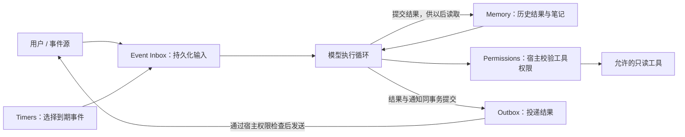

# agentd 最简系统设计（Codex）

基于 [完整架构](system-architecture-codex-latest.md) 删减，完整保留 **Event Inbox、Timers、Memory、Permissions、Outbox 五个组件**。采用一个 Go 进程、一个业务包、三张业务表，共十三个字段。五个组件是职责划分，不要求五个服务或五张表。

这是缩小能力范围后的独立首版方案，不是完整方案的等价压缩。适合定时检查、资料整理、生成草稿，并自动向用户发送结果。默认业务工具只读；唯一开放的远端写操作是向固定渠道、固定接收人投递结果。

**1. 使用边界决定复杂度**

- 单用户、单工作区、单进程，同一时刻执行一个请求；模型和渠道各先接一种。接收适配器校验身份，投递对象由宿主配置固定，模型不能选择收件人。
- 每条请求独立执行，可以读取近期已完成结果。没有 Task / Session 归并，也不推断“刚才那个任务”指的是哪个任务；需要改变计划时，由用户指定事件 ID 取消，再提交新请求。
- 支持一次性定时请求；执行成功后可以安排一次后续检查。不保证严格日历周期、错过时间补跑或任意长度任务自动续接。
- 每条事件最多产生一条最终结果通知。Outbox 独立投递，不因为重试通知而重跑模型；不支持同一事件多条消息、多收件人或中途进度推送。

**2. 五个组件，一条主链路**



| 组件 | 最小实现 | 存在哪里 |
| --- | --- | --- |
| Event Inbox | 验证身份、去重、持久化和领取输入 | events |
| Timers | 用 due_at 持久化一次性唤醒，到期交给同一执行循环 | 复用 events，无 timers 表 |
| Memory | 自动保存已完成结果；按需读取历史及用户维护的偏好和 Skills | 复用 events.input/output，加只读 Markdown 文件 |
| Permissions | 固定工具与资源白名单；限制时间、输出及通知目标；未知能力拒绝 | 宿主配置，无权限表 |
| Outbox | 结果提交时入队，独立发送、退避、处理结果未知 | outbox，正文引用 events.output |

代码仍只有宿主与执行器两个主要职责：宿主负责数据库、调度、授权和通知，执行器负责有界模型循环，通过宿主函数使用工具。Permissions 是代码检查，不是提示词；工具和投递共用检查入口，但不拆独立网关服务。内存通知只负责让宿主尽快查库，SQLite 才是待办事实。

**3. 三张表，十三个字段**

```sql
CREATE TABLE events (
    id       INTEGER PRIMARY KEY AUTOINCREMENT,
    key      TEXT NOT NULL UNIQUE,
    input    TEXT NOT NULL,
    due_at   INTEGER NOT NULL,
    status   TEXT NOT NULL DEFAULT 'pending'
             CHECK (status IN ('pending', 'running', 'done', 'failed', 'cancelled')),
    failures INTEGER NOT NULL DEFAULT 0 CHECK (failures >= 0),
    output   TEXT
);

CREATE INDEX events_due ON events(status, due_at, id);

CREATE TABLE outbox (
    event_id INTEGER PRIMARY KEY REFERENCES events(id),
    status   TEXT NOT NULL DEFAULT 'pending'
             CHECK (status IN ('pending', 'sending', 'sent', 'unknown', 'failed')),
    failures INTEGER NOT NULL DEFAULT 0 CHECK (failures >= 0),
    due_at   INTEGER NOT NULL
);

CREATE INDEX outbox_due ON outbox(status, due_at, event_id);

CREATE TABLE control (
    id     INTEGER PRIMARY KEY CHECK (id = 1),
    paused INTEGER NOT NULL DEFAULT 0 CHECK (paused IN (0, 1))
);
INSERT INTO control(id, paused) VALUES (1, 0);
```

events 七个字段，outbox 四个字段，control 两个字段，共十三个。SQLite 每个连接启用外键约束。所有时间为 UTC Unix 毫秒。字段含义如下，不再另藏一套 JSON 状态机：

| 字段 | 用途 |
| --- | --- |
| events.id | 本地身份、查询和取消的引用；同到期时间的排序依据 |
| events.key | 接收幂等键，由可信适配器生成，例如 `channel:account:event_id` |
| events.input | 归一化后的纯文本请求，创建后不改写 |
| events.due_at | 下一次允许执行的时间；立即请求取接收时间，定时请求取指定时间，失败时改为退避时间 |
| events.status | 当前是否可执行、正在执行或已终结 |
| events.failures | 仅记录真实执行失败和进程崩溃中断 |
| events.output | 成功结果或最近错误；由 status 区分，文本限制大小 |
| outbox.event_id | 同时作为主键、外键和投递去重依据；一个事件至多一条通知 |
| outbox.status | 等待发送、正在发送、已发送、结果未知或已明确失败 |
| outbox.failures | 仅记录确认未成功的投递失败，不和模型执行失败混用 |
| outbox.due_at | 下一次允许发送的时间，失败后用于退避 |
| control.id | 固定为 1，确保仅一行全局控制状态 |
| control.paused | 重启后仍有效的暂停开关 |

不存 workspace_id、task_id、session_id、run_id、owner_id、epoch、priority、batch_key、order_key、created_at、updated_at。单实例、独立请求和有限审计需求使这些字段暂时没有必要；这不是把它们换个名字塞进 input。

Outbox 不存独立 id、body、target、idempotency_key：event_id 已经唯一，正文读取终态事件的 output，目标固定在宿主配置，远端幂等键可由数据库生命周期内不变的实例标识和 event_id 派生。实例标识、投递目标及正文格式在存在未解决投递时不可变更；更换目标需先处理旧队列。done / failed 事件的 input/output 不再修改，重新执行必须创建新事件，保证待发送正文稳定。

十三个是数据库列数，不代表全部信息只需十三项：权限、固定收件人和模型等静态配置仍然存在。没有审计时间线、远端回执详情或每一步工具历史，这是删字段的明确代价。Outbox 未解决前不能删除对应事件；保留去重记录期间才能保证旧输入不被当作新输入。

去重命中时比较归一化 input；内容不同则拒绝冲突，不覆盖旧事件、不重置时间。执行过程中 due_at 可以变化，因此不把它当作原始请求时间证明。调用方若要调整时间，取消旧事件并使用新 key 提交。

**4. 主循环只有六步**

1. **接收**：验证身份与大小，短事务插入事件，提交后 ACK。定时请求也直接写 events，不建立 timers 表。
2. **选择**：未暂停时，在短事务内选择 `pending AND due_at <= now`，按 `due_at, id` 取一条并改为 running。没有工作就等待通知或最近到期时间，另保留一秒兜底扫描。
3. **执行**：事务外调用 Execute；提供当前请求、有限的近期已完成结果和人工维护的 MEMORY.md。数据库连接不跨模型或工具调用持有。
4. **成功**：一个事务写 output、标 done、插入 outbox；如返回后续检查，同时插入下一条 pending 事件，其 key 固定为 `followup:<当前 id>`。重试提交不能生成第二个后续事件或第二条通知。
5. **失败**：一个事务增加 failures、保存经脱敏的错误，并设置短退避；累计三次失败后标 failed，同时插入 outbox 通知用户。取消、暂停不计故障。启动恢复发现崩溃次数超限时使用同一终结事务。
6. **发送与等待**：独立投递循环选择到期 outbox，完成权限检查后发送；无到期执行或投递时等待通知和定时器，不调用模型。

这里不做防抖、消息合批、自动抢占或 Steer。失败退避只延迟这一条独立请求，其他请求可以先执行；因此不承诺聊天指令的全局先后覆盖语义。执行器也不更新全局预算偏好等共享配置，避免旧请求晚执行覆盖新指令。

执行器返回的后续检查是建议：宿主校验时间、频率和输入大小后才入库。最多一个后续事件，初期设置固定最小间隔，例如十分钟；不实现多分支任务树。需要精确周期任务时再增加独立 schedule，不让模型负责精确计时。

**Outbox 只需要以下状态规则：**

- 短事务领取 pending → sending，提交后调用发送 API，再用短事务保存 sent；网络调用不占数据库事务。
- 明确未发送成功的可恢复错误增加 failures 并退避；不可恢复错误或累计三次失败进入 failed。
- 超时、断连等无法判定是否送达时进入 unknown；重启遗留的 sending 也进入 unknown，不能当作普通 pending 自动重发。
- unknown 默认由用户核对：确认已送达则标 sent；确认未送达后才允许重试。渠道支持可靠的幂等重试或查询时，可由薄适配器核对；否则保持 unknown，不承诺恰好一次。

一条 unknown 通知不阻塞其他通知，但本地状态页必须显示；它不能靠“再生成一个通知 ID”被绕过。首版不为未知结果保存专用远端回执，接受人工核对这一运维成本。

**5. Go 接口与文件结构**

```go
// 同一个 internal/agent 包；领域类型不跨包来回转换。
type Request struct {
    ID     int64
    Input  string
}

type Result struct {
    Text   string
    Next   *FollowUp // nil 表示不再唤醒；仅成功提交时生效。
}

type FollowUp struct {
    At     time.Time
    Input  string
}

type Executor interface {
    Execute(ctx context.Context, req Request) (Result, error)
}
```

接收、查询、取消和暂停使用同包具体函数即可。没有 SaveStep、BoundaryHook、HostStateMutator、ActionCoordinator 等跨模块接口；执行器每次模型/工具调用前检查 ctx，宿主通过取消 Context 停止当前执行。

```text
cmd/agentd/main.go        启动、实例锁、依赖组装和退出
internal/agent/
  host.go                Event Inbox、Timers、主循环和控制
  store.go               三张表与短事务
  outbox.go              通知领取、发送和结果记录
  memory.go              有限历史和 Markdown 上下文加载
  execute.go             有界模型循环
  tools.go               Permissions 检查、受控读取和临时计算
  model.go               一种模型的薄适配
data/state.db            唯一调度与结果存储
data/config.yaml         宿主配置：工具白名单、固定投递目标和限额
workspace/MEMORY.md      用户维护，Agent 只读
workspace/skills/        用户安装，Agent 只读
scratch/                 临时计算目录，按执行尝试隔离
```

沿用 Go、net/http、database/sql 和 modernc.org/sqlite；没有 ORM 或通用 Repository。一个写池串行短写事务，另一个只读池用于查询结果。配置集中在启动配置中，包括模型、允许的数据源、超时、步数和输出上限；只有运行时暂停状态需要单独持久化。

**6. 为了删除复杂恢复，必须守住这些限制**

**单实例。** 启动时取得本地操作系统排他文件锁，进程存活期间一直持有；第二个实例直接拒绝启动。数据库只放本机磁盘，不支持多机、共享盘或在线接管。模型和工具超时后，必须确认本地执行已退出，才启动下一条；无法确认时停止调度。无需租约和 epoch 的前提是确实没有两个宿主同时执行。

**崩溃可以从头执行。** 重启取得实例锁后，将遗留 running 记一次中断失败，按上述退避规则回 pending 或 failed。模型和只读查询可能重复、也可能再次计费；不恢复原生工具调用中间态。只读工具与按尝试隔离的临时计算使重跑不产生重复远端写操作。孤儿本地子进程须在启动下一次执行前清理，不能只重置数据库状态。

**Permissions 由宿主保证。** 模型只可使用固定数据源的只读工具，不直接获得生产凭证或任意公网 HTTP。通知发送是独立授权能力，仅 Outbox 可向配置中的本人目标发送已提交结果，不能通过模型工具参数扩大收件范围。凭证只供宿主适配器使用。必须运行 bash 时才接现成隔离环境：禁直连网络、无数据库挂载、无生产密钥，仅 scratch 可写。没有可用隔离环境就先不开 bash；不新建 agentctl、凭证代理和沙箱 IPC 服务。

**Memory 和结果共用存储。** 已完成事件的 input/output 是自动积累的持久记忆，下一次执行按数量和 Token 上限加载近期结果，需要旧结果时通过只读工具按 ID 或文本查询。MEMORY.md 保存用户维护的长期偏好，skills/ 保存用户安装的说明，Agent 默认只读；不新增 memory 表、向量库或自动摘要任务。历史文本不能充当新的授权，也不能证明通知已送达，发送事实必须查看 outbox.status。

**结果只生成一次。** 最终 output 在入 Outbox 前进行权限检查、脱敏与长度校验，大小不得超过固定渠道单条可发送上限；大成果首版要求拆小请求。查询接口仍可读取本地结果和投递状态，需鉴权且默认只监听本机。接收 ACK、执行完成和通知送达是三个不同事实。

**长任务分成有限尝试。** 每次执行有固定步数、输入/输出 Token 和时间上限，例如十步、六十秒；工具输出截断。达到限制即返回已完成的阶段结果，或明确报错，不自动创建无限即时继续事件。不做在线压缩和复杂检查点，长期上下文来自已提交结果和人工维护的笔记。宿主限制每小时启动次数，重启时从空配额保守恢复；达到上限延后执行，避免模型自行无限唤醒。

**暂停与取消走宿主。** 暂停先持久化 paused，再取消当前 Context；正常停止后将当前事件退回 pending。暂停也禁止新 Outbox 发送，投递在发送前再次检查；检查与发起调用同暂停操作串行协调，已在途请求仍保存结果，不能承诺撤回。单事件取消仅适用于 pending / running，将其改为 cancelled 后取消对应 Context；已经提交结果的事件不通过取消修改正文。迟到的执行结果不能覆盖 cancelled，也不能在 paused 后提交新的后续事件。继续操作清除 paused；进程关闭遵循先停执行、后关库顺序。

**7. 与完整版本相比，具体删掉什么**

| 删除或合并 | 换来的简单 | 明确放弃的首版能力 |
| --- | --- | --- |
| 五个组件放在同一 Go 包，宿主与执行器分工 | 一个执行接口，无跨包状态回调 | 独立网关复用和复杂包隔离 |
| Task / Run / Session 表 | 一条事件就是一次有界执行 | 多目标管理、会话迁移和中途恢复 |
| 独立 timers 表 | Timers 直接选择 events 的未来 due_at | 严格周期、补跑策略和复杂日历 |
| 通用 Action 与审批系统 | 业务只读；通知由专用 Outbox 记录，保留 unknown | 任意远端写操作与异步审批 |
| Outbox 正文、收件人等重复字段 | 引用事件结果，固定一个投递目标 | 多消息、多收件人、复杂投递审计 |
| 独立 Memory 和 Permissions 表 | 历史结果、文件与静态宿主策略 | 动态授权、多用户权限、自动知识整理 |
| 租约、续租、epoch | 操作系统锁保证唯一实例 | 高可用、分布式接管 |
| 防抖、优先级、Steer | 按到期时间取一个请求 | 即时插话和复杂对话调度 |
| 会话逐步持久化、自动记忆写入 | 只提交最终结果 | 精细审计、自动更新共享记忆 |

模型升级主要替换 model.go 和执行提示；宿主只判断时间、状态与限额。不能依靠“模型更聪明”取消持久化和权限检查，也不为尚未开放的能力预建字段。

**8. 何时才加回复杂度**

通知以外的第一条远端写需求出现时，再加通用动作账本、幂等与 unknown 核对；需要人工批准时再加绑定冻结内容的审批。需要多收件人或单事件多条消息时，为 Outbox 增加独立 ID、目标和冻结正文。需要多实例时重新引入租约与 fencing；需要多个长期目标时再加 Task，而不是把越来越多的状态藏进 input 文本。

为什么不继续把 Outbox 合进 events：执行与投递有不同的状态、失败次数和到期时间，硬合并仍需增加三组字段，还会让两个循环争改同一行。三张表保持各自状态清楚，不是数学上的绝对最少，但适合这个范围。若再加周期、多用户等需求，应明确增加字段，不能宣称十三个字段足以覆盖完整系统。

首版验收：重复输入只保存一次；未来事件到期执行；重启继续未完成请求；历史结果可供下次读取；越权工具或投递目标被拒绝；结果与 Outbox 同事务提交；发送失败不重跑模型；遗留 sending 转 unknown 而非重发；暂停重启后仍有效；取消后的迟到结果不覆盖状态；同一次成功只产生一个后续事件。代码实现前不声称这些检查已经通过。
