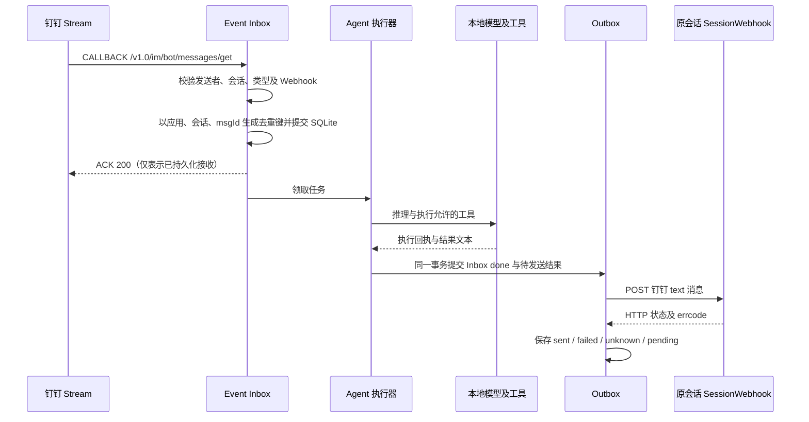

# 钉钉接入

本文描述钉钉渠道现在的实现与接入步骤，随代码更新。首次接入时（2026-11-17）的验证记录见 [钉钉接入验证报告](../reports/2026-11-17-dingtalk-integration.md)。

当前版本支持同一钉钉私聊的连续上下文。启用 OpenCode 后，其会话、工具与当前配置见 [项目运行说明](../../README.md#opencode-执行与钉钉连续对话)。

## 1. 实际执行路径



Stream 仅用于接收消息。结果发送采用消息中的临时 `sessionWebhook`，过期时间来自 `sessionWebhookExpiredTime`。这是钉钉区分接收与回复的协议要求，不能在 Stream ACK 中塞入结果来替代发消息。[钉钉官方回复说明](https://open-dingtalk.github.io/developerpedia/docs/learn/bot/appbot/reply/)

实现文件：

- `internal/agent/dingtalk.go`：连接、重连、心跳、接收校验、去重、来源路由、钉钉响应解析。协议对照 [官方 Go SDK](https://github.com/open-dingtalk/dingtalk-stream-sdk-go)；WebSocket 传输使用 Gorilla，生命周期交由 agentd 的 context 管理。
- `internal/agent/loop.go`：钉钉任务默认将最终回答排入 Outbox；如果模型已调用 `send_message`，不额外重复发送最终回答。
- `internal/agent/outbox.go`：投递和结果状态管理。
- `internal/agent/dingtalk_test.go`：协议、故障、持久化、审批续跑和真实模型测试。

消息来源元数据保存在 `inbox.payload.dingtalk`，Outbox 只保存 `dingtalk:<原始事件 ID>` 引用。模型看不到 Webhook URL，也不能指定另一个用户或群的接收地址。短期会话 URL 只存于宿主数据库；日志和列表 API 对它脱敏。

## 2. 接入真实钉钉

1. 在钉钉开发者后台为企业内部应用启用机器人，并配置 Stream 接收方式，完成发布及测试人员可见范围配置。使用应用 Client ID / Client Secret；群自定义机器人的单独 Webhook 不能替代 Stream 应用凭证。
2. 将 `config.yaml` 复制为已被 Git 忽略的 `config.local.yaml`，在本地填入凭证，不提交到版本库。它是完整配置文件，不是对 `config.yaml` 的增量覆盖。
3. 初次不知道用户/会话 ID 时，先开启只发现身份的模式：

```yaml
dingtalk:
  enabled: true
  client_id: "填写应用 Client ID"
  client_secret: "填写应用 Client Secret"
  discovery_only: true
  allowed_sender: ""
  allowed_conversations: []
```

```sh
chmod 600 config.local.yaml
make build
./bin/agentd -config config.local.yaml -root .
```

日志出现 `dingtalk stream connected` 后，使用指定测试账号给机器人发一条私聊消息。发现模式只记录 `sender_staff_id`、`conversation_id` 和会话类型，不执行任务、不回复消息、不打印消息正文及 Webhook。

4. 将日志中的真实 ID 写回配置，关闭进程后重启：

```yaml
dingtalk:
  enabled: true
  client_id: "填写应用 Client ID"
  client_secret: "填写应用 Client Secret"
  discovery_only: false
  allowed_sender: "日志中的 sender_staff_id"
  allowed_conversations:
    - "日志中的 conversation_id"
```

保留 `permissions.send_message: allow`。在 `config.local.yaml` 的 `dingtalk` 下设置 `allow_all_groups: true` 并重启 agentd 后，所有者在机器人已加入的任意群里 @机器人即可触发，以后加群即时适用。设为 `false` 时，群 ID 需列入 `allowed_conversations`。两种模式都核对发送者和 @ 标记；回复发回原群。

5. 在该测试会话发送一次：

> 请使用 write_file 创建 notes/dingtalk-cloud-check.md，内容为 DINGTALK_CLOUD_OK，expected_hash 为 absent。完成后回复文件路径及内容。不要使用 bash。

6. 验收四项证据：

- 日志 `dingtalk inbox accepted` 对应一个事件；API `/v1/inbox` 中该事件最终为 `done`。
- 项目 `workspace/notes/dingtalk-cloud-check.md` 实际存在且内容正确。
- `/v1/outbox` 对应 `dingtalk:<事件 ID>` 的结果为 `sent`。
- 原测试会话实际收到正确回复，其他会话未收到消息。最后一项需真实钉钉客户端观察，不能用本地测试代替。

本机查询命令：

```sh
TOKEN=$(cat data/api-token)
curl -s http://127.0.0.1:8090/v1/status -H "Authorization: Bearer $TOKEN"
curl -s http://127.0.0.1:8090/v1/inbox -H "Authorization: Bearer $TOKEN"
curl -s http://127.0.0.1:8090/v1/outbox -H "Authorization: Bearer $TOKEN"
```

`/v1/status` 包含 `dingtalk.enabled / connected / discovery_only`。连接状态只代表 Stream 连接建立，不代表结果已送达。

## 3. 复现测试与当前边界

```sh
make dingtalk-test   # 钉钉协议及故障测试；真实模型测试默认跳过
make dingtalk-live   # 真实本地模型 + 模拟钉钉收发；不使用真实应用凭证
make test
make race
make vet
make build
```

- 当前是一个所有者共享一个工作区；不是多租户系统。群白名单意味着允许将该所有者委托的结果公开到该群，应限定在测试群。工作区 Memory 与文件仍由所有者共享，聊天缓存隔离不等于数据隔离。
- 只支持文本任务和文本回复。引用回复时，被引用消息的文字作为参考资料附在任务后面，读不到原文时提示用户粘贴；图片、语音等暂时忽略；超出 4,000 字节的输出以截断文本回复，完整结果保留在本机 Outbox（仍受全局输出上限约束）。
- 直接 IM 回复和新闻主动私聊都绕过夜间静默；其他后台通知仍遵循静默策略。
- 钉钉事件逐条执行，不和其他会话合批；当前全局队列的顺序、预算、暂停和死信阻塞规则保持不变。`/pause` 仍需通过本机控制 API，不是钉钉聊天命令。
- 审批使用现有认证 HTTP API，未实现钉钉审批卡片。等待审批过久导致会话 URL 过期时，动作仍可有独立执行回执，但 IM 回复会失败。
- 主动私聊只用于 [AI 资讯推送](../../README.md#钉钉-ai-资讯定时私聊)：以应用 AccessToken 调用机器人单聊批量发送接口（`oToMessages/batchSend`），只发给 `allowed_sender`，要求 `enabled: true`、`discovery_only: false` 且 `permissions.send_message: allow`。模型的 `send_message` 不能借这条通道主动私聊，只能回复当前会话。回执判定：HTTP 200 且返回 `processQueryKey` 为 `sent`；401 清掉 token 后重试，429 或被限流为 `pending`；其他 4xx 或无效用户为 `failed`；其余情况为 `unknown`。
- 钉钉任务中的 `set_timer` 会明确返回不支持，不会创建定时器，也不会静默改成只投递到本地的提醒。项目本机 Timers 功能仍可使用。
- 进程内执行失败可生成失败通知；崩溃恢复直接形成的死信仍需管理员通过现有本机接口处理。
- 不确定的外部发送不会自动重试，因此不承诺“恰好一次”送达。Stream 重连功能已实现，但真实钉钉网关握手、应用权限、发布范围及真实断网恢复仍待有凭证时验收。
