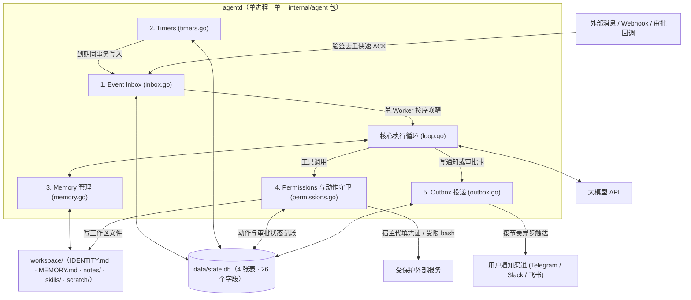

# agentd 第一阶段架构基线：五大原语最简系统设计

> **文档状态：第一阶段设计基线（已实现，2026-11）。** 本文定义第一阶段的架构边界：1 个进程、1 个业务包、5 个组件、4 张表、6 个工具。后续阶段在此基础上演进，原文保留不改，变更记录在后续阶段文档中。
>
> - **后续阶段**：[第二阶段：记忆模块设计（部分实现）](02-stage-2-memory.md)。它将取代本文中 Memory 组件的部分：§1 表格中的 Memory 行、§3 中的 `workspace/` 目录与 `session.jsonl`，以及 §4.2 第 4 条。
> - **路径**：§3 中的 `data/`、`workspace/` 位于仓库目录下。目标是迁入仓库下的状态根目录 `.agentd/` 并按角色隔离，见[运行状态目录与路径约定](90-convention-storage-layout.md)。
> - **实现后的扩展**：第一阶段完成后新增了钉钉和企微 IM 渠道、新闻推送、OpenCode 执行器（`im.go`、`dingtalk.go`、`wecom.go`、`news.go`、`opencode.go` 等），本文没有覆盖。它们曾把渠道和业务的判断写进 Inbox、Outbox 和执行循环，偏离了本文"渠道只是 Outbox 的投递目标"的边界；2026-11 已集中迁移到渠道接口和业务入口，接入方式见 [AGENTS.md](../../AGENTS.md) 的"架构不变量"。规模预算（4 张表、26 个字段、6 个工具）未变。

**原标题**：agentd 五大原语最简系统设计（Minimal Complete Edition）

> **设计目标**：完整保留 **Event Inbox、Timers、Memory、Permissions、Outbox** 五大核心原语（具备独立周期任务、可写记忆、按需静默/通知、非阻塞审批与外部写防重），同时将单机实现的包结构、表数量和字段数保持在精简可维护的水平。
> **系统规模**：**1 个 Go 进程 · 1 个业务包 `internal/agent` · 4 张表（共 26 个字段）· 6 个基础工具**。

---

## 1. 五大必备组件与单包结构（1 对 1 映射）

所有核心逻辑收敛在**同一个 `internal/agent` Go 包**内（仅保留模型 API 调用接口边界），五大组件直接对应 5 个源码文件：

| 必备组件 | 对应源码文件 | 持久化载体 | 最小闭环机制 |
| :--- | :--- | :--- | :--- |
| **1. Event Inbox** | `internal/agent/inbox.go` | **`inbox` 表（6 列）** | 落库即 ACK、`dedup_key` 去重、**固定 1 秒窗口合批**、单 Worker 严格按序消费 |
| **2. Timers** | `internal/agent/timers.go` | **`timers` 表（5 列）** | `cron_expr` 可空合一支持单次 Follow-up 与周期 Schedule；到期同事务转入 `inbox` |
| **3. Memory** | `internal/agent/memory.go` | **文件目录（0 张表）** | `IDENTITY.md` + `MEMORY.md`（常驻索引）+ `notes/*.md`（按需详情与任务进度）+ `session.jsonl`（可丢弃滑动上下文缓存） |
| **4. Permissions** | `internal/agent/permissions.go` | **`actions` 表（8 列）** + 代码守卫 | 宿主隔离密钥 + `allow/ask/deny` 拦截 + **外部写动作状态记账（含审批挂起与 `unknown` 防重）** |
| **5. Outbox** | `internal/agent/outbox.go` | **`outbox` 表（7 列）** | 解耦推理与发送，支持静默时段顺延、限速重试、**`sending -> unknown` 防崩溃重发**，兼作已发通知历史 |



---

## 2. 数据库表结构（4 张表，合计 26 个字段）

`Memory` 使用纯文本文件目录（0 张数据库表）；单机唯一实例由操作系统排他文件锁（`flock`）保证；暂停状态由持久化标记文件 `data/paused.lock` 表达。`data/state.db`（开启 `WAL` 模式）包含以下 4 张状态表：

```sql
PRAGMA journal_mode = WAL;
PRAGMA busy_timeout = 5000;

-- 表 1：Event Inbox（6 个字段）
CREATE TABLE inbox (
    id           INTEGER PRIMARY KEY AUTOINCREMENT, -- 入库严格单调递增序号
    dedup_key    TEXT NOT NULL UNIQUE,              -- 幂等键："tg:msg_88" / "timer:t1:173000" / "act:a1:approved"
    payload      TEXT NOT NULL,                     -- 归一化事件内容（JSON）
    available_at INTEGER NOT NULL,                  -- 允许消费时间 Unix ms（固定 1s 合批窗口 / 失败退避时间）
    status       TEXT NOT NULL DEFAULT 'pending'
                 CHECK (status IN ('pending', 'running', 'done', 'dead')),
    retries      INTEGER NOT NULL DEFAULT 0         -- 仅计入运行故障与崩溃中断，满 3 次转入 dead
);
CREATE INDEX idx_inbox_ready ON inbox(status, id);

-- 表 2：Timers（5 个字段，合一承载 Follow-ups 与 Schedules）
CREATE TABLE timers (
    id           TEXT PRIMARY KEY,
    cron_expr    TEXT,                              -- NULL = 单次跟进 (Follow-up)；非空 = 周期任务 (Schedule)
    fire_at      INTEGER NOT NULL,                  -- 下次触发时间 Unix ms
    prompt       TEXT NOT NULL,                     -- 到期推入 inbox.payload 的唤醒指令
    active       INTEGER NOT NULL DEFAULT 1         -- 1 = 启用中，0 = 单次已触发或已取消
);
CREATE INDEX idx_timers_due ON timers(active, fire_at);

-- 表 3：Permissions 受控外部写动作与审批表（8 个字段，覆盖 ask 审批与 allow 外部写防重）
CREATE TABLE actions (
    id           TEXT PRIMARY KEY,
    dedup_key    TEXT NOT NULL UNIQUE,              -- 绑定发起源（如 "ev:{inbox_id}:{step}"），防崩溃重跑重复建单
    tool_name    TEXT NOT NULL,                     -- 受控工具或外部写动作名
    tool_args    TEXT NOT NULL,                     -- 冻结的参数 JSON（防审批后篡改）
    resume_hint  TEXT NOT NULL DEFAULT '',          -- 审批挂起时的上下文简述，供唤醒后衔接
    status       TEXT NOT NULL
                 CHECK (status IN ('pending_approval', 'approved', 'rejected', 'executing', 'succeeded', 'failed', 'unknown')),
    expires_at   INTEGER NOT NULL,                  -- 审批有效截止时间 Unix ms（自动 allow 动作置为当前时间）
    result       TEXT                               -- 已确认的执行回执或失败原因（重跑时直接复用，不再调远端）
);

-- 表 4：Outbox（7 个字段，承载异步降噪投递、结果未知保护与已发通知历史）
CREATE TABLE outbox (
    id           INTEGER PRIMARY KEY AUTOINCREMENT,
    dedup_key    TEXT NOT NULL UNIQUE,              -- 本地入队防重键
    target       TEXT NOT NULL,                     -- 渠道与接收目标，如 "telegram:123456"
    content      TEXT NOT NULL,                     -- 精简结论文本或审批卡片
    deliver_at   INTEGER NOT NULL,                  -- 允许发送时间 Unix ms（限速、夜间免打扰顺延与明确失败退避）
    status       TEXT NOT NULL DEFAULT 'pending'
                 CHECK (status IN ('pending', 'sending', 'sent', 'failed', 'unknown')),
    retries      INTEGER NOT NULL DEFAULT 0         -- 仅计明确未送达的可恢复错误
);
CREATE INDEX idx_outbox_due ON outbox(status, deliver_at);
```

### 关键字段与状态设计说明

1. **为什么不做滑动防抖，而做“固定 1 秒窗口合批”（0 额外时间列）**：
   新普通消息到达时，查询是否存在 `status = 'pending' AND retries = 0 AND available_at > now` 的开放批次：若存在，新消息**直接复用该开放批次的 `available_at`（不向后顺延）**；若不存在，则设 `available_at = now + 1000ms` 开启新窗口。无需增加 `first_seen_at` 列，即可合并 1 秒内的连续短消息且绝不无限推迟。
2. **为什么把 `approvals` 扩展为 8 列的 `actions` 表**：
   仅记录 `approved` 无法防止“远端写动作已成功、但本地事件标 `done` 前崩溃导致重启二次执行”。将人工审批（`ask`）与自动放行（`allow`）的**外部写动作**统一记入 `actions`：发起远端请求前先短事务置 `executing`，明确成功后存 `result` 并置 `succeeded`，超时断连或崩溃遗留 `executing` 统一转 `unknown`（停止自动重发，等待核对）。纯只读工具与写本地 `workspace/` 笔记无需进此表。
3. **Outbox 的 `sending -> unknown` 与防重历史复用**：
   发送前短事务先将 `pending` 改为 `sending`，网络调用在事务外进行；超时、断连或进程重启发现遗留 `sending` 时统一转为 `unknown`（不盲目重发，交人工确认或渠道幂等查询）。同时查询最近 10 条 `status = 'sent'` 记录即可作为 [背景文章解析](00-background-always-on-agents.md)中的 **Past messages（已发通知防重参考）**。

---

## 3. 代码与文件目录（单包结构）

```text
agentd/
├── cmd/agentd/main.go          # 启动入口：获取单实例 flock、执行启动恢复、管理退出顺序
├── internal/agent/             # 唯一业务包
│   ├── inbox.go                # 组件 1：接收去重、固定 1s 合批、队头按序领取与完成
│   ├── timers.go               # 组件 2：Follow-ups 与 Cron 扫描，同事务写入 inbox
│   ├── memory.go               # 组件 3：加载常驻索引、读写笔记、维护 session.jsonl 缓存
│   ├── permissions.go          # 组件 4：allow/ask/deny 判定、凭证隔离、actions 状态机
│   ├── outbox.go               # 组件 5：pending->sending->sent/unknown 投递与静默期控制
│   ├── loop.go                 # 核心 Agent Loop、宿主状态锁协调与 6 个基础工具分发
│   └── model.go                # 模型 API 薄适配（模型升级主要替换点）
├── config.yaml                 # 模型配置、宿主私有外部凭证、工具规则、静默时段与限额
├── data/                       # [宿主私有，子进程不可见]
│   ├── agentd.lock             # 单实例排他文件锁
│   ├── paused.lock             # 存在时表示处于全局暂停态（跨重启保留）
│   ├── state.db                # 上述 4 张表（26 列）
│   └── session.jsonl           # 近期对话滑动窗口缓存（非动作事实证据，超阈值摘要轮转）
└── workspace/                  # [Memory 载体：纯文本目录，Git 可追踪]
    ├── IDENTITY.md             # [每次必加载 · Agent 只读] 用户长期指令
    ├── MEMORY.md               # [每次必加载 · Agent 可读写] 偏好索引与活跃任务指针
    ├── notes/                  # [按需加载 · Agent 可读写] 细分笔记详情 + 长任务进度
    ├── skills/                 # [按需加载 · Agent 只读] 外部工具/CLI 使用说明 (*.md)
    └── scratch/                # [临时草稿 · Agent 可读写] 临时脚本与超 16KB 工具输出截断文件
```

---

## 4. 核心运行与故障闭环规则

### 4.1 三条后台循环的协作

1. **Timer 循环**：非暂停态下每秒扫描 `active = 1 AND fire_at <= now`，在同一短事务中写入 `inbox`（`dedup_key = "timer:" + id + ":" + fire_at`）并更新 `active = 0` 或下次 `fire_at`，随后通知 `wakeupCh`。
2. **Inbox Worker 循环（严格串行）**：
   - **队头按序合批**：仅当全局最早一条 `pending` 事件（`ORDER BY id ASC LIMIT 1`）满足 `available_at <= now` 时，取出从队头起连续已到期的 `pending` 事件置为 `running`（若队头尚在退避，后续事件等待队头，不乱序越过；`dead` 事件需人工处理或显式清理）。
   - **审批恢复**：若事件为 `approval:<action_id>`，查询 `actions` 表——若已 `succeeded` 直接取 `result`；若为 `unknown` 提示待核对；若为 `approved` 且未过期，先短事务改为 `executing`，在事务外执行冻结的 `tool_name(tool_args)`，再持久化 `succeeded/failed/unknown` 后将结果交给模型继续收尾；若拒绝或已过期，告知模型放弃该动作。
   - **推理与工具守卫**：加载 `IDENTITY.md` + `MEMORY.md` + 最近已发 `outbox` 摘要 + `session.jsonl` 调用模型；暴露 **6 个基础工具**（`bash`、`read_file`、`write_file`、`edit_file`、`set_timer`、`send_message`）：
     - 只读与本地笔记写入（`allow`）：直接执行（超 16KB 输出落 `scratch/` 返回预览）；
     - 自动放行的外部写操作（`allow`）：同样先按稳定 `dedup_key` 登记或复用 `actions` 表记录，遵循 `executing -> succeeded / unknown` 防重；
     - 需确认操作（`ask`）：同事务写入 `actions(pending_approval)` + `outbox(审批卡)` + 标当前 `inbox` 事件为 `done`，**立即结束本轮释放 Worker（0 Token 休眠）**；
     - 禁止操作（`deny`）：直接返回拒绝原因。
3. **Outbox 循环**：非暂停态下领取到期 `pending` 记录置为 `sending`，提交事务后调用渠道发送，再按明确结果置 `sent`、退避回 `pending`（满 3 次置 `failed`）或异常置 `unknown`。

### 4.2 单机并发、取消与进程边界约束

1. **单实例与启动恢复**：启动时对 `data/agentd.lock` 获取非阻塞排他 `flock`，拒绝双实例启动。启动后在开放接入前执行恢复事务：① `inbox` 中遗留的 `running` 计一次 `retries` 退回 `pending`（满 3 次转 `dead`）；② `actions` 中遗留的 `executing` 与 `outbox` 中遗留的 `sending` 统一转为 `unknown`，绝不盲目自动重发外部副作用。
2. **暂停/停止与提交串行裁决**：宿主使用同一把进程内互斥锁协调 `/pause`、`/stop` 与 Worker / Outbox 的领取及最终状态提交（避免“刚检查完 `ctx.Err() == nil` 就在提交前被取消覆盖”的竞态）。`/pause` 先落盘 `data/paused.lock` 再取消当前 `Context`，阻止新 Run 领取与新 Outbox 发送；主动暂停或 `/stop` 中止的 `running` 事件退回 `pending` 且**不增加 `retries` 故障计数**。
3. **子进程生命周期边界**：运行期间 `bash` 启用独立进程组（`Setpgid: true`），超时或 `/stop` 时向进程组发送终止信号并等待退出后再允许启动下一轮；若宿主进程自身遭遇 `SIGKILL` 或断电强退，残留子进程回收依赖操作系统服务管理器（如 `systemd` KillMode / 容器生命周期 / `launchd`），不在应用文档中承诺跨强杀自行寻回孤儿进程。
4. **`session.jsonl` 定位边界**：`session.jsonl` 仅作为提升对话连贯性的可丢弃上下文缓存（读取时忽略极端断电可能产生的尾部残损行），**绝不作为外部写动作是否已执行的判断依据**——一切外部写事实以 `actions` 与 `outbox` 表为准。
