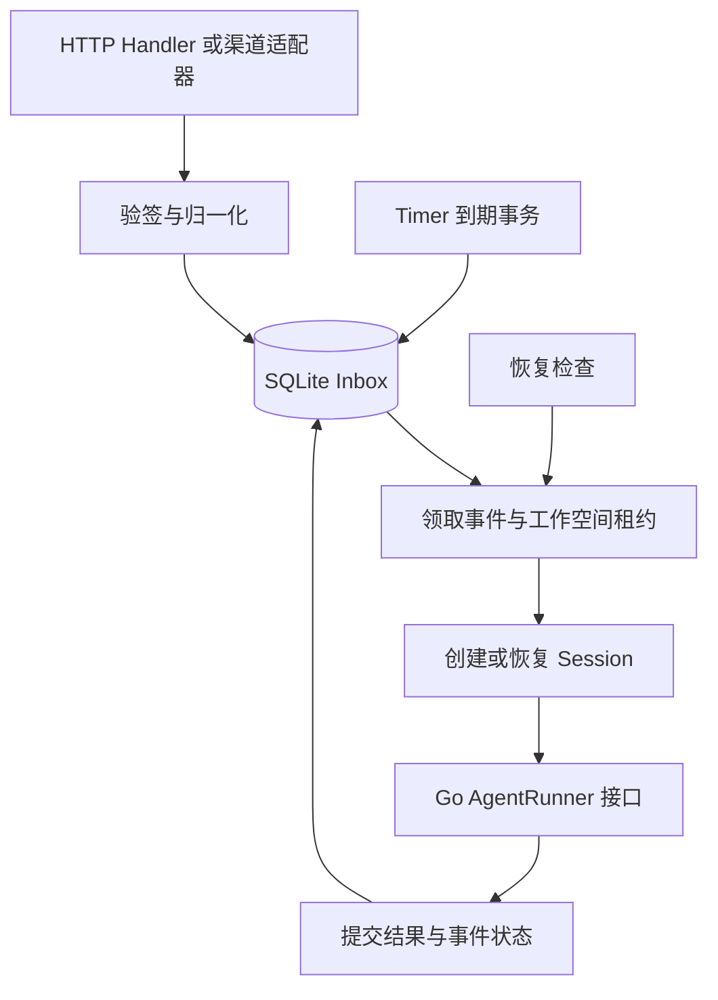

# Event Inbox 模块 Go 实现设计

本文定义 agentd 的 Event Inbox 实现边界、数据结构、Go 接口、事务流程和验收条件，基于 [README](README.md) 与 [最新版总体设计](always-on-agent-design-codex-latest.md)。目标是单机、小团队场景下可靠接收事件、串行推进任务，并在进程中断后恢复。

首版使用 Go 标准库、SQLite 和进程内唤醒通知。Inbox 是运行控制器的内部能力，不是独立微服务；它不理解业务意图，不直接执行外部写动作，也不实现模型推理。本文代码是实现契约与示意片段，不是已经交付的运行代码。

**1 技术选择与职责**

| 能力 | 首版选择 | 边界 |
| --- | --- | --- |
| HTTP 接入 | net/http | 验签、限流、限制请求体、归一化和提交事件 |
| 数据访问 | database/sql | 参数化 SQL，短事务，无 ORM |
| SQLite 驱动 | modernc.org/sqlite | 无 CGo 依赖；实施时固定兼容的 Go 与驱动版本 |
| 并发 | goroutine、context.Context、channel | 接入与心跳并发，每工作空间仅一个活跃 Run |
| 唤醒 | 容量为 1 的通知 channel 加定期查表 | channel 不保存事件，不承担可靠投递 |
| 取消 | context.WithCancel 和持久化控制标志 | 取消本地调用不等于撤销远端动作 |
| 日志 | log/slog | 记录事件、Run 和 epoch；默认不记录完整消息正文 |

modernc.org/sqlite 提供 database/sql 驱动及无 CGo 实现，并支持通过 DSN 配置事务锁模式和连接级 PRAGMA。[驱动文档](https://pkg.go.dev/modernc.org/sqlite)

首版一个工作空间对应一个逻辑 Inbox。未来若每用户独立 Inbox 但共享工作区，仍需在共同工作区层串行执行，不能只靠每个 Inbox 自己加锁。

| Inbox 自己负责 | 依赖其他控制器能力 |
| --- | --- |
| 事件格式、去重、顺序、合批、领取、完成和重试 | Task 创建与更新、Session 解析和交接 |
| 验证领取者 owner/epoch，维护事件处理状态 | Run 状态、预算、暂停、取消和租约心跳 |
| 将待执行事件交给执行器 | 工具授权、Action 幂等和 unknown 核对 |

**2 运行链路**



外部事件在数据库提交成功后才返回 ACK。内部 timer、作业结果、审批答复也必须写入 Inbox，不能直接拉起 Agent。管理命令 /pause、/stop 走鉴权后的带外控制路径，不等待普通事件消费者，但仍记录审计信息。

**3 事件信封**

```go
type Envelope struct {
    WorkspaceID    string
    Source         string          // 渠道 + 账户或安装实例
    ExternalID     string          // 上游事件 ID 或内部稳定发生键
    Kind           string          // user.message、timer.fired 等
    ConversationID string
    ActorID        string
    TaskID         *string         // 无明确关联时为 nil
    ReplyTo        *string
    Payload        json.RawMessage
}
```

上例使用 encoding/json。WorkspaceID、ActorID、Source 由经过验证的渠道配置和身份映射得到，不信任消息正文中的同名字段。TaskID 与 ReplyTo 只有在验证所有权及访问权限后才能成为可信路由依据。事件内容仍是不可信业务数据。

去重键为 `(workspace_id, source, external_id)`。不同账户可能产生相同 ExternalID，因此账户身份必须进入 Source。没有稳定上游 ID 时，应由接入协议提供幂等键；不能声称能彻底去重，也不能用正文 hash 过滤用户有意重复发送的内容。

同一去重键再次到达时返回原 event_id，不覆盖原载荷、不重置防抖时间。若适配器归一化后的不可变业务载荷不同，记录冲突并拒绝静默覆盖；签名、投递时间等会变化的传输字段不纳入该业务载荷比较。

**4 持久化结构**

以下 SQL 定义 Inbox 自身的数据与共享租约。Run、Session、Task、Action、outbox、控制状态属于总体设计中的其他表，不在这里复制 Schema。集成迁移应补齐跨表约束；所有跨模块操作使用同一个 SQLite 数据库。

```sql
CREATE TABLE inbox_events (
    seq                  INTEGER PRIMARY KEY AUTOINCREMENT,
    event_id             TEXT NOT NULL UNIQUE,
    workspace_id         TEXT NOT NULL,
    source               TEXT NOT NULL,
    external_id          TEXT NOT NULL,
    event_type           TEXT NOT NULL,
    conversation_id      TEXT,
    actor_id             TEXT,
    task_id              TEXT,
    reply_to             TEXT,
    payload_json         TEXT NOT NULL,
    payload_hash         TEXT NOT NULL,
    order_key            TEXT NOT NULL,
    batch_key            TEXT,
    priority             INTEGER NOT NULL DEFAULT 0,
    status               TEXT NOT NULL DEFAULT 'pending'
                         CHECK (status IN ('pending','processing','done','dead')),
    received_at_ms       INTEGER NOT NULL,
    available_at_ms      INTEGER NOT NULL,
    failure_count        INTEGER NOT NULL DEFAULT 0 CHECK (failure_count >= 0),
    claimed_run_id       TEXT,
    claimed_epoch        INTEGER,
    last_error_code      TEXT,
    completed_at_ms      INTEGER,
    UNIQUE (workspace_id, source, external_id)
);

CREATE INDEX inbox_ready ON inbox_events
    (workspace_id, status, priority DESC, seq ASC, available_at_ms);
CREATE INDEX inbox_order_blockers ON inbox_events
    (workspace_id, order_key, seq)
    WHERE status IN ('pending','processing','dead');
CREATE INDEX inbox_batch ON inbox_events
    (workspace_id, batch_key, status, seq);
CREATE INDEX inbox_claimed ON inbox_events
    (workspace_id, claimed_run_id, status);

CREATE TABLE workspace_leases (
    workspace_id         TEXT PRIMARY KEY,
    owner_id             TEXT,
    active_run_id        TEXT,
    epoch                INTEGER NOT NULL DEFAULT 0,
    lease_until_ms       INTEGER NOT NULL DEFAULT 0
);
```

字段约束与解释：

- event_id 使用宿主生成的随机唯一 ID，不能由模型指定。seq 仅表示本机入库顺序，不保证外部事件发生顺序。
- received_at_ms 和 available_at_ms 使用宿主 UTC Unix 毫秒。available_at_ms 控制短防抖和失败退避，未来业务计划仍留在 timers 表。
- order_key 定义必须按序处理的流，与 batch_key 分离。普通用户消息按可信渠道账户、会话和主体构造，绑定 Task 前后不改变已有键；无会话的独立事件使用自身稳定事件键。内部继续事件按 Task 构造自己的顺序流，审批及远端回执使用独立关联流，避免被它要解除的等待状态阻塞。第一版不承诺跨渠道全局时间顺序。
- batch_key 由可信渠道、会话、主体和明确任务关联生成，只决定能否合并输入，不能用于代替长期顺序流。审批、定时事件默认不合批；没有可靠会话键时设为 NULL。
- priority 越大越优先：后台 0，人工普通消息 10，已鉴权审批答复 20。/pause、/stop 不参加队列排序，走带外控制路径。同 order_key 内顺序优先于 priority；所有优先级仍服从暂停、熔断与租约约束。
- failure_count 仅计入已确认的运行故障或异常中断，不在领取时增加。正常 yield、Steer、等待审批、主动取消和可持久化的正常退出均不增加；单次失败的计数在 Run 的故障记账事务中幂等提交。
- claimed_run_id/epoch 是当前或最后领取信息；处理历史由 Run 与 Session 记录保存，不因重试覆盖而丢失。
- 重复投递保护只在去重记录保留期间有效。清理 done 载荷后仍保留覆盖上游重投窗口的键记录；dead 需人工处理或明确保留策略。

workspace_leases.active_run_id 关联总体设计的 runs 表，避免重复存储 run_kind 和 task_id。runs 必须提供 run_id、workspace_id、kind（foreground/background/recovery）、task_id、session_id、status、yield_requested、checkpoint_ref 及故障记账标记。Append 在其写事务内联查有效租约与 runs，判断是否设置 yield_requested；Task 绑定变化与 Run 关联更新也在事务中完成。没有有效活跃 Run 时只入队。

**5 Go 包与接口**

```text
internal/controller/
  ingress.go          # Webhook、出站长连接或轮询的接入适配器接口
  inbox.go            # Envelope、Event、Claim 与 Store 方法
  inbox_sqlite.go     # 参数化 SQL、事务内辅助函数
  worker.go           # 唤醒、领取、运行、提交、恢复
  control.go          # 暂停、抢占、取消和预算
  migrations/         # 与整体 state.db 共用迁移序列
```

这些是同一个包中的职责分组，不要求一开始建立多个 Go package。先实现一个具体 SQLite Store，只在 AgentRunner 和渠道适配器处保留接口；不要提前抽象出支持多种数据库的仓储框架。

```go
// internal/controller 方法签名契约，省略 import 和领域类型定义。
type AgentRunner interface {
    Run(ctx context.Context, input executor.RunInput) (executor.RunOutcome, error)
}

type ClaimResult struct {
    Claim          *Claim
    NextWakeAt     *time.Time // 已考虑队头、租约、暂停及熔断的唤醒提示
    RecoveryNeeded bool
}

// executor.RunInput 携带 executor.BoundaryHook。
// 执行器在每次模型调用和工具执行前后调用，返回 executor.Directive / []executor.InputEvent。

func (s *Store) Append(ctx context.Context, e Envelope) (AppendResult, error)
func (s *Store) ClaimBatch(ctx context.Context, workspace, owner string) (ClaimResult, error)
func (s *Store) OnBoundary(ctx context.Context, claim Claim) (executor.Directive, []executor.InputEvent, error)
func (s *Store) AttachSteer(ctx context.Context, claim Claim) ([]Event, error)
func (s *Store) Renew(ctx context.Context, claim Claim) error
func (s *Store) CommitOutcome(ctx context.Context, claim Claim, out executor.RunOutcome) error
func (s *Store) RecordFailure(ctx context.Context, claim Claim, failure Failure) error
func (s *Store) BeginRecovery(ctx context.Context, workspace, owner string) (*RecoveryTicket, error)
func (s *Store) FinishRecovery(ctx context.Context, ticket RecoveryTicket, out RecoveryOutcome) error
```

跨包类型与 [系统架构接口](system-architecture-codex-latest.md) 对齐：RunInput、RunOutcome、InputEvent、TaskSnapshot、SessionSnapshot、Budget、SessionStep、Directive 和 BoundaryHook 定义在 executor；controller 定义 AgentRunner 消费方接口，以及持久化 Event、Claim 等记录。调用 Run 前将记录转换为输入视图；OnBoundary 在同一短事务内检查控制状态、附加事件后，返回转换后的 executor.InputEvent，保留 event_id、顺序与任务关联。AttachSteer 仍返回 controller.Event 供内部使用。executor 不导入 controller，不复制两套 BoundaryHook 或 Directive。

AppendResult 包含原 event_id 和 inserted 标志。Claim 包含 workspace_id、owner_id、epoch、run_id、session_id、事件列表及当前租约期限。ClaimResult 没有就绪工作时 Claim 为 nil；RecoveryNeeded 为 true 时调用独立恢复流程，NextWakeAt 仅为调度提示，不授予执行权。ErrLeaseLost 表示调用者必须停止发起新动作，不允许按普通瞬时错误重试提交。

Directive 为 continue、yield 或 stop。worker 将绑定当前 claim 的 OnBoundary 注入 RunInput，执行器收到新事件后按持久 Session 顺序装配下一输入。回调内部短事务检查控制状态并调用 attachSteerTx；禁止事务内调用会另开事务的 AttachSteer 公共方法。已经收到尚未处理的 Steer 时，下一次必须先调用模型处理纠偏，不继续执行旧模型响应中剩余的工具计划。

需要原子提交的 timer、Run、outbox 操作使用 `appendTx(ctx, tx, ...)` 等包内函数。禁止在外层事务中调用会自行开启事务的 Append，避免嵌套事务或单连接死锁。

**6 数据库连接与事务约定**

对同一 state.db 使用读写两个 database/sql 句柄。writeDB 单连接，配置 `_txlock=immediate`，仅用于短写事务及其一致性读取；readDB 最多四连接，配置 `mode=ro`、`query_only(1)` 和 deferred 事务，供历史及状态只读查询。事务内查询仍使用同一个 sql.Tx，不能切去 readDB 获取旧快照。[Go 事务指南](https://go.dev/doc/database/execute-transactions)

```go
// 连接示例：导入 database/sql，并空白导入 modernc.org/sqlite。
writeDSN := "file:./data/state.db?_pragma=journal_mode(WAL)" +
    "&_pragma=synchronous(FULL)&_pragma=foreign_keys(1)" +
    "&_pragma=busy_timeout(1000)&_txlock=immediate"
writeDB, err := sql.Open("sqlite", writeDSN)
if err != nil {
    return err
}
writeDB.SetMaxOpenConns(1)
writeDB.SetMaxIdleConns(1)
// 完成 writeDB.Ping、迁移和 WAL 验证后才打开 readDB；错误路径关闭已开句柄。
readDSN := "file:./data/state.db?mode=ro&_pragma=query_only(1)" +
    "&_pragma=busy_timeout(1000)&_txlock=deferred"
readDB, err := sql.Open("sqlite", readDSN)
if err != nil {
    writeDB.Close()
    return err
}
readDB.SetMaxOpenConns(4)
readDB.SetMaxIdleConns(4)
```

DSN 由可信本地配置生成，不接受用户消息拼接。启动时创建权限受限的 data/，先初始化写库，再 Ping 读库并核验 PRAGMA；失败则关闭句柄且不开放接收成功响应。每个新连接都应用各自配置。读池仅用于可容忍快照变化的查询；领取、去重、防抖、续租、控制检查和提交条件必须在 writeDB 的同一事务内完成。

双池避免慢历史读取占住唯一写连接，但不保证“永不阻塞”或“不会 SQLITE_BUSY”：写操作仍相互排队，其他进程、锁和存储压力仍会影响运行。长期读事务也可能阻碍 WAL 回收。读查询分页、限时并及时关闭 Rows，写事务不得包含模型或网络调用，保留 SQLITE_BUSY 有界退避。[Go 连接池](https://go.dev/doc/database/manage-connections)、[SQLite WAL](https://www.sqlite.org/wal.html)

BeginTx 后不再手动执行 BEGIN IMMEDIATE；驱动锁模式承担这一行为。不要在 sql.DB 连接池上分别 Exec BEGIN、UPDATE、COMMIT，避免事务语句落在不同连接。不得在写事务内再通过 writeDB 获取连接；需一致快照的纯读事务走 readDB，不能将只读 BeginTx 送入 immediate 写池。监控两个池的 WaitCount、WaitDuration、事务耗时和续租余量，不把独立 goroutine 当成实时续租保证。

**7 接收流程与 ACK**

接收顺序固定为：限制请求体 → 对原始请求验签与鉴权 → 归一化 → 验证字段和访问范围 → 短事务插入 → 提交 → 唤醒通知 → 渠道要求的 ACK。

```sql
INSERT INTO inbox_events (
    event_id, workspace_id, source, external_id, event_type,
    payload_json, payload_hash, order_key, received_at_ms, available_at_ms
) VALUES (?, ?, ?, ?, ?, ?, ?, ?, ?, ?)
ON CONFLICT(workspace_id, source, external_id) DO NOTHING;
```

上面仅展示必需字段插入，完整实现同时写入主体、关联键和宿主优先级。使用 RowsAffected 判断新插入，冲突时读原记录并验证载荷一致。ACK 代表已持久化接收，不代表 Agent 已处理完毕。

| 结果 | Handler 行为 |
| --- | --- |
| 首次提交成功 | 按渠道协议返回成功 |
| 相同事件重投 | 返回成功，不增加事件和防抖延迟 |
| 鉴权失败或格式无效 | 对应拒绝响应，不入业务队列 |
| 入库失败、超时、磁盘满 | 不返回成功，让来源重试 |
| 提交结果不确定 | 重新查询去重键；无法确认时返回可重试失败，不能重新生成来源键 |

HTTP Request.Context 仅控制接收入库的期限。Run 使用进程级 Context 派生的独立 Context，不能沿用客户端断开就会取消的请求 Context。高成本内容检查与模型判断留在 Run 内；接收入口仍执行大小、身份和速率限制。

出站长连接与轮询适配器复用同一 Append，不要求部署公网 Webhook。业务事件成功提交后才按渠道协议 ACK 或推进消费游标；心跳和连接保活不受业务落库流程阻塞。批次共享游标时，仅确认全部已持久化的连续前缀；本地游标不得先于对应事件提交，失败后允许按稳定来源键重投去重。适配器明确各渠道的重投与确认语义，不承诺上游不支持的可靠投递能力。

**8 唤醒与 Go 并发模型**

```go
type Wakeup struct { ch chan struct{} }

func NewWakeup() *Wakeup {
    return &Wakeup{ch: make(chan struct{}, 1)}
}

func (w *Wakeup) Notify() {
    select {
    case w.ch <- struct{}{}:
    default: // 已有唤醒提示，允许合并。
    }
}
```

接收提交后 Notify。消费者启动时立即查表，无事件时 select 等待通知、最近可领取时间、周期兜底或 ctx.Done。首版兜底扫描可为 1 秒。消费者每次醒来都读数据库；不要在查表后无条件清空通知 channel，造成新通知被误吞。即使通知遗失，兜底扫描也必须能推进工作。

ClaimResult.NextWakeAt 是当前可推进顺序流队头的最早到期时间，并结合有效租约的截止时间和熔断 next_retry_at。不能直接取所有 pending 事件的 MIN(available_at_ms)：被旧事件阻塞的后续事件可能早已到期，导致 worker 零间隔空转。paused 或 dead 阻塞且没有其他可执行流时，只等控制通知和兜底扫描。

以下查询给出没有前序阻塞的 pending 队头的最早到期时间；它不是最终领取授权。控制器另行叠加有效租约和依赖冷却约束，只有无 claim 且不需恢复时才返回相应提示。

```sql
SELECT MIN(e.available_at_ms) FROM inbox_events AS e
WHERE e.workspace_id = ? AND e.status = 'pending'
  AND NOT EXISTS (
      SELECT 1 FROM inbox_events AS prev
      WHERE prev.workspace_id = e.workspace_id
        AND prev.order_key = e.order_key AND prev.seq < e.seq
        AND prev.status IN ('pending','processing','dead')
  );
```

worker 使用 time.Timer 等待 min(NextWakeAt、当前时间加 fallback_scan)，Notify 或 Context 取消可提前打断。每次醒来重新领取和计算提示；仅 worker goroutine 管理 Timer，按锁定 Go 版本正确处理 Stop/Reset，不由 Handler 并发 Reset。时间已经到期时重新查表，但若状态未变化且仍受阻，应返回真正解除阻塞的时间或只用兜底，不能 busy-loop。该机制避免依赖轮询相位，不承诺毫秒级调度实时性。

每工作空间一个 worker goroutine 调用 AgentRunner；HTTP 接入、控制信号和续租心跳使用独立 goroutine。执行器每次工具/模型调用边界检查持久化控制状态。活跃 Run 期间不能仅靠被 Run 阻塞的 worker select 接收抢占信号。

所有后台 goroutine 都受进程级 Context 管理并在退出时等待回收。不要为每条事件启动无界 goroutine；也不要把带大载荷的 Event 放入通知 channel。

**9 防抖与批次领取**

新插入的普通用户消息参与同一 batch_key 下未领取、未失败重试的开放批次。以 received_at 和 seq 确定先后；去重重投不改变时间。批次可领取时间：

```text
due = min(最后一条入库时间 + 1 秒, 第一条入库时间 + 3 秒)
```

Append 在同一事务中计算开放批次并更新这些事件的 available_at_ms。若既有批次已到 due，新事件不能把它重新延后，应开始下一批。第一版可利用同一 batch_key 和相同 due 区分开放批次，无需新增批次表；Claim 时按事件 ID 固定本次成员。

领取仅合并同一主体、会话、明确任务关联及批次的用户消息，按 seq 交给模型。审批、timer、继续事件默认单独领取。暂定单批最多 20 条、归一化载荷合计 64 KiB；超量剩余事件保持 pending，不能删除或误标完成。单条输入需单独限制体积或转为受控附件引用。

失败重试事件不重新参与新消息防抖，保留原 Run/检查点关联。领取采用同 order_key 队头约束：任何 seq 更小的 pending（包括退避中）、processing 或未处理 dead 都阻塞后续同流事件。只有不同流的就绪队头之间才按 priority DESC、seq ASC 选择。

```sql
SELECT e.* FROM inbox_events AS e
WHERE e.workspace_id = ? AND e.status = 'pending'
  AND e.available_at_ms <= ?
  AND NOT EXISTS (
      SELECT 1 FROM inbox_events AS prev
      WHERE prev.workspace_id = e.workspace_id
        AND prev.order_key = e.order_key AND prev.seq < e.seq
        AND prev.status IN ('pending','processing','dead')
  )
ORDER BY e.priority DESC, e.seq ASC
LIMIT 1;
```

以上查询选择批次头。随后只沿该 order_key 获取连续、到期、批次兼容的 pending 前缀，检查全部更早阻塞项都已纳入同批；不能对每条成员机械套用队头查询，也不能跳过不兼容或退避中的旧项。数据库写事务固定事件集合后再执行。

dead 默认阻塞该流，其他流可继续；授权用户可重试或显式 skip，skip 记录审计并将该事件以跳过结论终结，绝不能默认把失败的旧指令视为已成功。等待审批的原输入已交接完成，不保持 processing 等人，否则会阻塞后续答复。

严格顺序的代价是同流新消息也要等待旧失败的退避。首版接受这一取舍，并允许带外停止或显式 skip 解除；不让模型未经处理就猜测“新消息已覆盖旧消息”。以后若增加 supersede，应作为有审计和授权的独立状态变更设计，不通过随意修改 priority 绕过队头。

队头顺序保证入库事件的处理先后，不保证跨渠道绝对因果顺序，也不自动防止旧任务检查点覆盖新目标。继续 Run 必须重读当前 Task 版本和新用户指令，修改以 expected_version 校验；审批、回执和控制事件不能因顺序约束被其要解除的等待状态卡住。

inbox_ready 将排序列置于可用时间之前，支持优先级扫描；代价是可能扫描许多尚未到期的高优事件。原索引仍可用于到期过滤，不能简单称其完全失效。实施时用实际查询的 EXPLAIN QUERY PLAN 和代表性队列规模评估是否另加到期时间索引，不保证一个索引同时最优解决范围过滤、排序和队头检查。[SQLite 查询规划](https://www.sqlite.org/queryplanner.html)

**10 原子领取与租约**

ClaimBatch 在一个 immediate 短事务中完成：

1. 读取持久化暂停、预算和依赖熔断状态，无执行条件则返回空。
2. 建立或读取工作空间租约并联查 active_run_id。有效租约存在则返回等待提示；过期且有未完成 Run 时结束本事务，仅返回 RecoveryNeeded，不在领取事务中执行恢复查询或调用远端。
3. 选取到期且兼容的一批 pending 事件。没有事件则不占用空租约。
4. 增加 epoch，设置 owner_id、lease_until、active_run_id，创建 Run 并解析可信 Session 关联。
5. 条件更新选中事件为 processing，保存 run_id、epoch，不增加 failure_count；核验受影响行数。
6. 提交后调用 AgentRunner，模型与工具执行期间不持有数据库事务。

epoch 每次重新获取执行权递增，续租不增加；正常提交或交接后释放 owner、active_run_id 和期限，不删除租约行或重置 epoch。异常退出保留 active_run_id 供恢复。初始可使用 30 秒租期、每 10 秒续租，需大于短事务和数据库繁忙等待的正常延迟。

```sql
UPDATE workspace_leases
SET lease_until_ms = ?
WHERE workspace_id = ? AND owner_id = ? AND epoch = ?
  AND lease_until_ms > ?;
```

续租必须更新恰好一行。失败时取消 Run Context 并禁止新动作和状态提交。数据库提交与工具网关都核验 owner、epoch 和期限；已在途的外部请求仍靠 Action 账本核对，租约不能撤回它。

本机租约时钟来自宿主，不接受来源时间。检测到明显时钟跳变时取消当前执行并保守恢复，不把时钟假设当成外部副作用防重保证。

**11 Task 与 Session 路由**

明确 reply_to/task_id/approval_id 且有权限时恢复对应任务或审批 Session；无关联普通消息使用 task=nil 进入消息处理 Session。模型通过 manage_task 创建或绑定任务，Inbox 不做意图分类。

Run 必须有 session_id，task_id 可空。bind 已有 Task 的交接使用事务保存事件引用与去重继续事件，在工具边界结束分派 Run，再恢复目标 Session；不能在同一模型循环内突然替换聊天历史。具体契约沿用总体设计。

同一消息的处理和展示引用保持稳定。Session 按 event_id 去重追加，执行器不能因恢复而向历史重复追加同一用户消息。

**12 运行中新事件与取消**

| 到达事件 | 处理 |
| --- | --- |
| 明确关联当前 Task 的人工补充 | 入库后在下一安全边界通过 AttachSteerTx 原子归入当前 Run、追加 Session，并保留未处理状态 |
| 后台运行时收到其他人工消息 | 入库后设置持久化 yield_requested，发信号，保存进度后让出 |
| 普通后台事件 | pending 排队 |
| 已鉴权 /pause 或 /stop | 直接提交控制状态并取消可中止调用，不等待模型 |

OnBoundary 在同一个短事务内读取控制状态、联查 runs、校验租约，并按需调用 attachSteerTx。Steer 仅领取当前任务明确关联、同流没有未附加阻塞项的 pending 连续前缀；同一活跃 Run 已附加的前序事件允许一起处理，其他 Run 的 processing 或退避/dead 前序仍阻塞。这些事件也纳入最终 CommitOutcome，只有“已注入上下文”不能标 done。长调用中到达的取消由独立控制 goroutine 触发 Context，边界回调并不承担中断阻塞调用的职责。

工具边界协作式让出优先；宽限期到达后调用取消函数，外部已发送动作保留回执或 unknown。运行时代码不得把所有 context.Canceled 都当作可立即重试失败：暂停保留待续工作，永久取消按 Task 状态终结，租约丢失由新 owner 恢复。

**13 完成与重试事务**

CommitOutcome 使用一个短事务核验当前租约、保存 Run 检查点和任务进度、写等待或继续事件及 outbox，再将已消费事件标 done 并释放租约。outbox 只入队，不在此事务内发网络请求。

| Run 结果 | Inbox 行为 |
| --- | --- |
| completed，包括静默 | 保存结果后完成已消费输入；不自动代表 Task 完成 |
| waiting | 保存审批或其他等待条件、通知后完成原输入；未来回复是新事件 |
| yielded | 保存交接与唯一继续事件后完成已交接输入；没处理的事件回 pending |
| 可恢复故障 | 记录故障和检查点，未消费输入退避后 pending；保留原处理来源 |
| 超限或不可恢复 | 进入 dead，停止自动重试并告警 |

只更新属于该 claim 或经 AttachSteerTx 纳入的事件。去重继续键可由 run_id 和交接序号生成；事务重试不能生成第二个继续事件或第二份通知。

失败使用带抖动的有界退避，示例基数 1 秒、上限 60 秒，累计第 5 次可恢复失败时进入 dead。RecordFailure 先按当前 Run/执行 epoch 检查故障记账标记，再仅对受影响且未消费事件增加 failure_count，并原子设置退避或 dead；重复提交同一故障不重复计数。异常中断由 BeginRecovery 对被接管的执行代次记账一次，不能每次恢复扫描都加一次；正常 yield 不改变计数，DB 领取前的 busy 也不算业务事件失败。

业务拒绝、格式问题不按瞬时网络失败无限重试；服务级熔断优先于事件重试，到期事件留队等待，不持续唤醒模型。人工 replay 保留失败历史并记录新的重试授权，不重新制造无关联的写动作。

**14 崩溃恢复与已发生动作**

恢复由 worker 在 ClaimBatch 返回 RecoveryNeeded 后独立推进，拆成三个阶段：

1. BeginRecovery：写事务再次验证过期与未完成 Run，递增 epoch、设置恢复执行权，故障幂等记账，返回 RecoveryTicket（新 owner/epoch、旧 Run、事件与检查点引用）。竞争接管失败则返回空，不能沿用旧票据。
2. 事务外核对：读取历史与必要的远端状态；继续对恢复执行权心跳续租，禁止同一工作空间正常领取新 Run。远端查询不占数据库写事务。
3. FinishRecovery：短事务复核票据、保存核对结果，将未终结输入恢复为受退避约束的 pending，或保存等待与继续事件，再结束恢复并释放执行权。若恢复进程也崩溃，下次按新代次接管，已保存结果和故障记账不重复。

恢复时读取旧检查点、Session 和 Action：已成功动作复用回执；可能已发出但未保存结果的动作进入 unknown 核对；prepared 动作按总体设计要求确认后再执行。数据库事务外完成必要查询，再带新 epoch 提交恢复结果。若核对需要等待，持久化等待状态并释放执行槽。

不能全表执行 `UPDATE ... SET status='pending' WHERE status='processing'`，也不能把 README 的“安全重试”解释为重放所有工具调用。Inbox 保证至少一次处理，外部副作用是否能安全重试由工具网关决定。

**15 Timer 与统一事件来源**

Timer 到期时，在同一个 sql.Tx 内更新 timer 状态/下一发生时间，并调用 appendTx 插入稳定来源键 `timer_id:scheduled_at` 对应的事件。事务提交后 Notify。任务继续、审批答复、后台作业完成采用同一入口约定。

暂停或依赖熔断时沿用总体设计的 skip/coalesce/有限补跑策略。Timer 不能调用 AgentRunner，也不能把未来数月所有触发项提前塞入 Inbox。

**16 配置、资源与退出**

| 配置 | 建议初值 | 说明 |
| --- | --- | --- |
| fallback_scan | 1 秒 | 通知遗失兜底 |
| debounce / max_wait | 1 秒 / 3 秒 | 普通新消息合批 |
| max_batch_events / bytes | 20 / 64 KiB | 单 Run 输入边界 |
| lease / heartbeat | 30 秒 / 10 秒 | 运行执行权，不是数据库锁时长 |
| db_busy_timeout | 1 秒 | 还受调用 Context 截止时间限制 |
| max_failures / max_delay | 5 次失败 / 60 秒 | 不计正常领取与让出；服从服务熔断 |

输入限制、pending 数量和磁盘配额按部署规模配置。超过接收容量时返回渠道支持的重试错误，不先 ACK 后丢弃。事件大附件使用已持久化引用；载荷和正文不得无界进入日志或数据库。

进程退出先停止接受新请求/领取新 Run，向活跃 Run 发取消信号，在有限宽限期内保存状态并等 goroutine 退出。尚未安全交接的 processing 事件不标 done。若无法确认旧本地执行已经停止，不提前释放其执行权；进程退出后由租约恢复接管。最终关闭 readDB 和 writeDB，不能先关库再尝试保存进度。

记录 pending 数量、最老事件等待时间、重复/冲突事件、重试与 dead 数量、租约丢失、数据库繁忙、Run 时长和提交失败；维度避免使用无限增长的正文或用户输入。

**17 验收与实施顺序**

实现时使用 Go testing、httptest、临时文件 SQLite 和可控测试时钟；并发测试运行 go test -race。以下是实现阶段应建立的行为测试，不表示当前已有代码通过测试。

| 场景 | 必须满足 |
| --- | --- |
| 同一 webhook 并发到达多次 | 一条事件，一次有效领取，重复请求正常 ACK |
| 相同来源键不同载荷 | 不覆盖原事件，产生明确冲突 |
| 提交成功后、Notify 前进程退出 | 重启扫描发现事件 |
| 数据库提交失败或磁盘满 | 不返回成功 ACK |
| 两个 worker 同时领取 | 同一工作空间最多一个有效 epoch 执行 |
| 原 owner 暂停后恢复 | 旧 epoch 无法提交或发起新动作 |
| A 退避到 15 秒、同流 B 在 4 秒就绪 | B 不越过 A；独立流的就绪事件可执行 |
| 同流队头进入 dead | 后续事件不静默越过，明确 retry/skip 后才继续 |
| 正常事件连续被 yield 超过 5 次 | failure_count 不变，不进入 dead |
| RecordFailure 或恢复记账重复提交 | 同一执行代次只增加一次故障计数 |
| 不同流同时就绪且优先级不同 | priority 较大者优先，同流仍按 seq |
| readDB 保持慢历史查询 | 写池不被读连接占用；仍测量 ACK、续租延迟与 WAL 增长 |
| 过期 Run 需要远端核对 | 领取事务已结束，只有恢复票据持有执行权 |
| pending 后续项已到期但队头尚在退避 | NextWakeAt 指向可推进的队头，不产生零间隔空转 |
| 防抖截止早于下次兜底扫描 | Timer 按到期提示唤醒，不额外等待一整轮扫描 |
| 消息持续涌入 | 防抖不超过最大窗口，批次不无限增长 |
| Steer 后模型中断 | 不丢纠偏、不重复追加 Session |
| 等待审批 | 原事件已持久交接，执行槽释放，审批回复恢复正确 Session |
| 外部成功但回执未保存 | 进入 Action 核对，不因 Inbox 重试重复发送 |
| timer 更新中途崩溃 | timer 与事件要么同时提交，要么同时回滚 |
| paused 时重启及收到批准 | 仅保存输入，不执行新动作 |
| graceful shutdown 超时 | 未完成事件可恢复，无无界 goroutine 遗留 |

第一步实现 Append、唯一约束、HTTP ACK 和通知兜底；第二步实现 Claim、租约、Session 关联及事务提交；第三步实现恢复、限额、控制路径和行为测试。接入真实外部写操作前必须联通 Action 的幂等与 unknown 流程。所有步骤保持同一 Go 进程与同一 SQLite 数据库，不引入额外队列基础设施。
