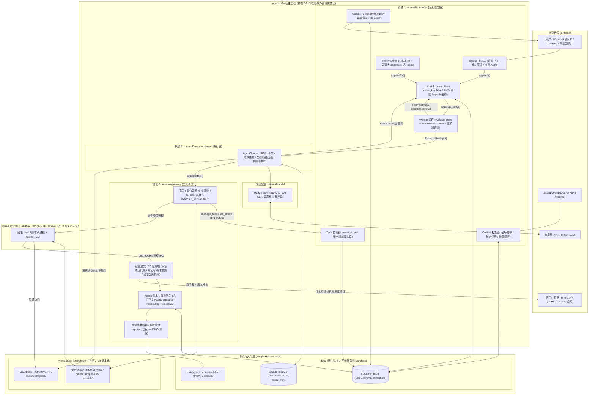
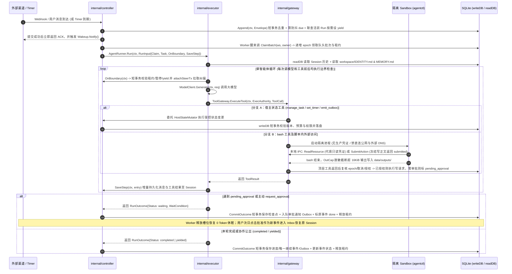

# agentd 系统全景架构与 Go 模块接口契约

> **设计基准**：综合 [README.md](README.md)（Anthropic 五大原语）、[always-on-agent-design-codex-latest.md](always-on-agent-design-codex-latest.md)（总体架构与安全不变量）与 [event-inbox-design-codex.md](event-inbox-design-codex.md)（Event Inbox Go 实现规格）。
> **定位**：面向 Go 编码落地的**模块划分、进程/存储隔离边界与跨模块接口定义蓝图**。

---

## 一、物理拓扑与 Go 代码目录规划

整套系统在单机部署时收敛为 **2 个二进制入口（或同一二进制的 2 个子命令）+ 3 个核心内部包 + 1 个薄模型适配包**，不引入任何外部消息队列、缓存或微服务框架：

```text
agentd/
├── cmd/
│   ├── agentd/                 # 宿主守护进程入口（持有 SQLite 写连接池与真实外部凭证）
│   └── agentctl/               # 沙箱内受控 CLI 入口（仅通过本地鉴权 IPC 请求宿主网关）
├── internal/
│   ├── controller/             # 模块 1：运行控制器（Inbox / Timers / Lease / Task / Control / Outbox）
│   ├── executor/               # 模块 2：Agent 执行器（Context 装配 / 单循环推进 / 在线摘要压缩）
│   ├── gateway/                # 模块 3：工具网关（8 基础工具 / Action 账本 / 审批冻结 / 沙箱 IPC / 大输出落盘）
│   └── model/                  # 可替换模型供应商适配层（唯一随模型 API 演进变化的薄层）
├── data/                       # [宿主私有，严禁挂载进沙箱]
│   ├── state.db                # SQLite WAL（writeDB 单连接 immediate + readDB 四连接 ro/query_only）
│   ├── policy.yaml             # 确定性权限、资源范围、预算上限、静默时段配置
│   ├── artifacts/              # 宿主管理的不可变成果快照（先写文件算 Hash，再入库登记）
│   └── outputs/                # 工具原始大输出落盘目录（单文件上限与保留期受控）
└── workspace/                  # [人机共读 Markdown 工作区，支持 Git 版本化]
    ├── IDENTITY.md             # [沙箱只读] 生效身份指令与风格边界（宿主审查安装）
    ├── skills/                 # [沙箱只读] 已批准生效的操作说明与脚本
    ├── progress/               # [沙箱只读] 从任务系统事实自动生成的可重建进度视图
    ├── MEMORY.md               # [受控读写] 简短记忆索引与用户偏好（带 expected_version 冲突检查）
    ├── notes/                  # [受控读写] 附来源的长期笔记档案
    ├── proposals/              # [受控读写] Agent 提议的身份指令与候选 Skill 待审区
    └── scratch/                # [受控读写] 临时脚本与计算草稿
```

### Anthropic 五大原语到 Go 模块的映射

| Anthropic 原语 | 承载模块与存储 | 核心落地方式 |
| :--- | :--- | :--- |
| **1. Event Inbox** | `internal/controller` + `state.db` | HTTP/渠道验签极速落库 ACK；`order_key` 保序；`batch_key` 1s/3s 合批；`epoch` 单飞租约 |
| **2. Timers** | `internal/controller` + `state.db` | 区分 `Schedules` 与关联 Task 的 `Follow-ups`；到期在同一 `sql.Tx` 内调 `appendTx` 入 Inbox |
| **3. Memory** | `workspace/` + `state.db` | 系统事实归 `state.db`；经验偏好归 `MEMORY.md`（索引）+ `notes/`（按需加载） |
| **4. Permissions** | `internal/gateway` + 隔离 Sandbox | 零密钥禁公网沙箱 + 显式宿主 IPC 读写分流 + `Action` 账本与顶层工具边界异步挂起审批 |
| **5. Outbox** | `internal/controller` + `state.db` | 与任务/成果提交同事务入队；独立 Dispatcher 处理静默时段延迟、去重投递与 `unknown` 核对 |

---

## 二、系统全景模块与隔离边界架构图



---

## 三、跨模块核心交互时序（常规执行与异步审批闭环）



---

## 四、模块间 Go 接口契约定义

除以下 **6 组跨边界接口** 外，各模块内部直接操作具体结构体与 SQLite 短事务函数，禁止引入泛化的 Repository 层或事件总线框架。

### 4.1 接入层 / 定时器 / 控制面 $\rightarrow$ `internal/controller`

将所有外部触发源、内部定时器和带外硬命令统一收口：

```go
package controller

import (
    "context"
    "database/sql"
    "encoding/json"
    "time"
)

type Envelope struct {
    WorkspaceID    string
    Source         string          // 渠道 + 账户实例（已验签映射）
    ExternalID     string          // 上游事件 ID 或 "timer:{id}:{scheduled_at}"
    Kind           string          // user.message | timer.fired | approval.resolved | action.receipt
    ConversationID string
    ActorID        string
    TaskID         *string         // 仅经鉴权确认归属时非 nil；普通自由对话为 nil
    ReplyTo        *string
    Payload        json.RawMessage
}

type AppendResult struct {
    EventID  string
    Inserted bool
}

// 1. 外部渠道与 Webhook 写入入口（内部开启 writeDB immediate 短事务，提交后触发 Wakeup.Notify）
func (s *Store) Append(ctx context.Context, env Envelope) (AppendResult, error)

// 2. 内部跨表原子投递入口（供 Timer 到期、yield 继续事件、审批结果在外层同一个 sql.Tx 内调用）
func (s *Store) appendTx(ctx context.Context, tx *sql.Tx, env Envelope) (AppendResult, error)

// 3. 带外控制入口（/pause, /stop, /resume：绕过普通队列与模型，直接持久化控制标志并取消可中止调用）
func (c *ControlPlane) ExecuteCommand(ctx context.Context, cmd AuthControlCommand) (ControlAck, error)
```

---

### 4.2 `internal/controller` $\leftrightarrow$ `internal/executor`

`controller` 掌控租约、并发、恢复与状态提交；`executor` 仅在给定租约与预算内推进单轮推理循环：

```go
package controller

type Directive string

const (
    DirectiveContinue Directive = "continue"
    DirectiveYield    Directive = "yield"
    DirectiveStop     Directive = "stop"
)

// Executor 在每次模型调用和工具执行前后必调的钩子（内部在短事务中核验 epoch、控制标志并执行 attachSteerTx）
type BoundaryHook func(ctx context.Context) (Directive, []Event, error)

type RunInput struct {
    Claim       Claim          // 含 WorkspaceID, OwnerID, Epoch, RunID, SessionID, Events
    Task        *TaskSnapshot  // task=nil 时表示未归属消息分派回合
    SessionInit SessionView    // 初始加载的指令引用、任务索引与最近会话记录
    Budget      RunBudget      // 单轮最大步数、Token 预留阈值、超时限制
    OnBoundary  BoundaryHook
    SaveStep    func(ctx context.Context, step SessionStep) error
}

type RunOutcome struct {
    Status        RunStatus       // completed | waiting | yielded | failed | cancelled
    Progress      ProgressPatch
    ArtifactRefs  []ArtifactRef
    EvidenceRefs  []EvidenceRef
    WaitCondition *WaitCondition  // Status == waiting 时必填（绑定 action_id 等）
    Continuation  *Continuation   // Status == yielded 时生成唯一去重继续事件
}

// Controller 调用 Executor 的唯一接口
type AgentRunner interface {
    Run(ctx context.Context, input RunInput) (RunOutcome, error)
}

// Worker 调度与三阶段崩溃恢复使用的 Store 核心契约
func (s *Store) ClaimBatch(ctx context.Context, workspace, owner string) (ClaimResult, error)
func (s *Store) Renew(ctx context.Context, claim Claim) error
func (s *Store) CommitOutcome(ctx context.Context, claim Claim, out RunOutcome) error
func (s *Store) RecordFailure(ctx context.Context, claim Claim, failure Failure) error
func (s *Store) BeginRecovery(ctx context.Context, workspace, owner string) (*RecoveryTicket, error)
func (s *Store) FinishRecovery(ctx context.Context, ticket RecoveryTicket, out RecoveryOutcome) error
```

---

### 4.3 `internal/executor` $\rightarrow$ `internal/gateway`（顶层工具调用边界）

模型默认只看到 8 个基础工具（`bash`、`read_file`、`write_file`、`edit_file`、`set_timer`、`emit_outbox`、`request_approval`、`manage_task`），调用身份与 `epoch` 由宿主强制注入，绝不信任模型参数自报：

```go
package gateway

import (
    "context"
    "encoding/json"
)

type ExecAuthority struct {
    WorkspaceID string
    OwnerID     string
    Epoch       int64
    RunID       string
    SessionID   string
    TaskID      *string
    ActorID     string
}

type ToolCall struct {
    CallID string
    Name   string
    Args   json.RawMessage
}

type ToolResult struct {
    Output          string          // 大输出已截断为 <=16KiB 预览 + data/outputs/ 受控读取引用
    PendingApproval *ApprovalTicket // 若顶层复核判定需要人工审批，通知 Executor 在工具边界转入 waiting 结束 Run
    TaskChanged     *TaskTransition // manage_task 触发 create 或 bind 已有任务时的会话交接指示
    IsError         bool
}

type ToolGateway interface {
    ExecuteTool(ctx context.Context, auth ExecAuthority, call ToolCall) (ToolResult, error)
}
```

---

### 4.4 `internal/gateway` $\rightarrow$ `internal/controller`（受控宿主状态变更回调）

由于任务生命周期、定时器和 Outbox 的唯一写入负责人是 `controller`，`gateway` 在处理这三类工具时通过窄接口委托回 `controller`：

```go
package controller

type HostStateMutator interface {
    // 对应 manage_task 工具：按 request_key 幂等执行 create / update / bind，校验 expected_version 与权限
    ManageTask(ctx context.Context, auth ExecAuthority, req ManageTaskReq) (ManageTaskResp, error)
    // 对应 set_timer 工具：必须已绑定有效 Task（或授权周期任务），受任务截止时间与总预算约束
    MutateTimer(ctx context.Context, auth ExecAuthority, req TimerMutationReq) (TimerMutationResp, error)
    // 对应 emit_outbox 工具：创建持久化投递意图（遵循静默时段与幂等投递键）
    EnqueueOutbox(ctx context.Context, auth ExecAuthority, req OutboxEnqueueReq) (string, error)
}
```

---

### 4.5 隔离沙箱 `cmd/agentctl` $\rightarrow$ `internal/gateway`（跨进程安全 IPC 接口）

沙箱默认禁公网、禁外部 DNS、无生产凭证，只能通过挂载的本地受保护 Unix Domain Socket（携带单次 `Run` 绑定的短期鉴权令牌）访问宿主的 **3 条显式分流通道**：

```go
package gateway

type SandboxIPCService interface {
    // 通道 1：受限只读查询（固定服务映射 + 只读权限凭证代填；越权写请求同步返回拒绝错误，不阻塞挂起脚本）
    ReadExternal(ctx context.Context, runToken string, req ScopedReadRequest) (ScopedReadResponse, error)

    // 通道 2：显式命名写动作（如 "github.create_issue"）
    // Submit 立即复制并冻结请求正文快照，登记为 prepared 返回 action_id，绝不在脚本内阻塞等人类审批；
    // 待顶层 bash 工具返回后，由 Gateway 统一复核取消/纠偏/授权，自动执行或转为 pending_approval。
    SubmitAction(ctx context.Context, runToken string, req NamedActionSubmit) (ActionTicket, error)
    GetActionStatus(ctx context.Context, runToken string, actionID string) (ActionRecord, error)
    ContinueAction(ctx context.Context, runToken string, actionID string) (ActionRecord, error)

    // 通道 3：受限公网抓取（宿主解析 DNS，拒绝环回/私网/云元数据 IP，逐跳校验重定向，禁止携带工作区敏感内容外送）
    FetchPublic(ctx context.Context, runToken string, req PublicFetchRequest) (PublicFetchResponse, error)
}
```

---

### 4.6 `internal/executor` $\rightarrow$ `internal/model`（可替换大模型适配接口）

将供应商特定 SDK / HTTP 协议彻底隔离在此接口之后，保留原生工具调用格式与原始响应归档：

```go
package model

import "context"

type Client interface {
    Generate(ctx context.Context, req GenerateRequest) (GenerateResponse, error)
}
```

---

## 五、全系统状态与文件写权限总表（安全不变量核对单）

| 状态表 / 目录资产 | `controller` | `executor` | `gateway` | `sandbox (bash)` | 核心保护机制 |
| :--- | :---: | :---: | :---: | :---: | :--- |
| **`state.db`：events / tasks / runs / timers / leases / control** | **唯一读写** | 只读快照 | 经 `HostStateMutator` 委托 | 物理不可见 | `writeDB` 单连接 `immediate` 短事务 + `epoch` 核验 |
| **`state.db`：session_entries（对话与工具历史）** | 恢复/审计读 | **经 `SaveStep` 追加** | — | 物理不可见 | 按 `event_id` / 步骤序号幂等追加，防崩溃丢现场 |
| **`state.db`：actions / 审批状态 + `data/artifacts/` & `outputs/`** | 恢复时协调对账 | 只读引用 | **唯一读写** | 经 IPC 提交意图 | 请求参数与文件正文 SHA-256 绑定；超时进 `unknown` |
| **`workspace/IDENTITY.md`、`skills/`、`progress/`** | 重建 `progress/` | 只读加载 | 审批核验 Hash 后安装 | **只读挂载** | 防间接提示词注入篡改系统身份与技能形成持久后门 |
| **`workspace/MEMORY.md`、`notes/`、`proposals/`、`scratch/`** | — | 只读加载 | **临时文件原子替换 + `expected_version`** | 可读写（脚本优先写 `scratch/`） | 防后台 Run 静默覆盖用户手工编辑的内容 |

---

## 六、抗模型跨档升级隔离验证

当底层大模型发生跨代跃迁（如上下文窗口扩充、原生规划能力大幅增强、新工具协议演进）时，各模块的改动半径如下：

1. **`internal/controller`（0 改动）**：事件持久化、防抖合批、`order_key` 保序、租约 `epoch`、崩溃三阶段恢复、Timer 脉冲与带外 `/pause` 均属纯确定性调度基础设施，与模型智商完全正交。
2. **`internal/gateway`（0 改动）**：沙箱网络/文件隔离边界、`Action` 幂等与 `unknown` 核对账本、审批 Hash 绑定属于物理安全边界，模型越强越需要这道确定性闸门。
3. **`internal/model` + `internal/executor` 配置项（局部轻量更新）**：仅需替换 `model.Client` 适配器、调整上下文压缩预算阈值，并按总体设计的回归评测集对比“新模型 + 简化提示词配置”，安全删减不再需要的历史提示词补丁。
